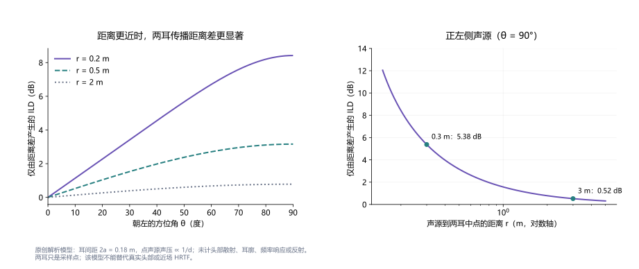
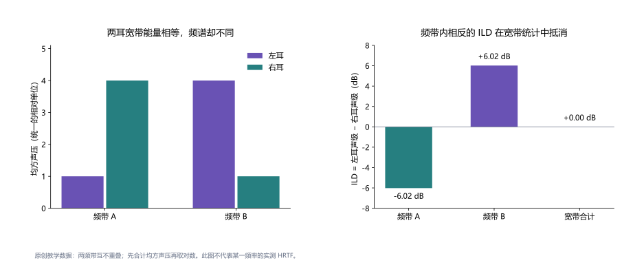
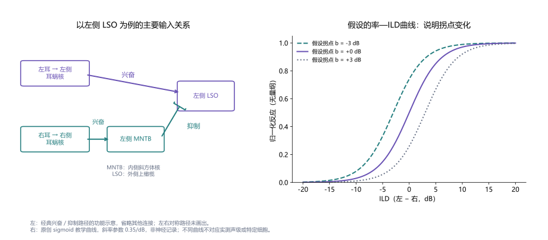
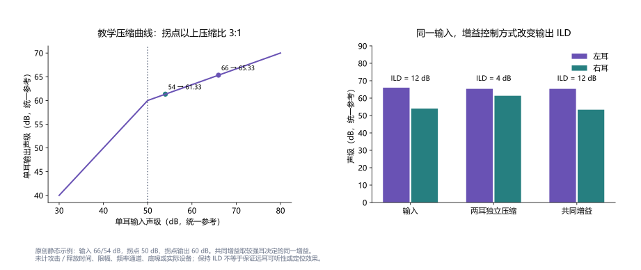

**双耳强度差**（Interaural Level Difference，**ILD**）是到达两耳的声音电平之差，与[双耳时间差](../interaural-time-difference/)共同构成[空间听觉](../spatial-hearing/)的重要线索。中文“强度差”沿用经典术语；涉及测量时，更准确的名称是**双耳声级差**。通常比较的是两耳同一频带、同一时间范围内的声压级，单位为分贝（dB），并非把两个以W/m²表示的物理声强直接相减。[1](#ref-bipm-decibel-2026)

侧方声音到达近耳与远耳时，传播距离、头部散射和外耳方向滤波不同，因而产生ILD。经典解释强调高频头影，但这不是一个“低频没有ILD、高频只有ILD”的严格分界。距离、环境、频带和刺激形式都会改变线索；耳机中的声像偏移、自由场定位和噪声中的言语理解也不是同一个任务。[2](#ref-tollin-lso-2003)[3](#ref-grothe-localization-2010)

本词条从物理定义、声学来源和神经机制出发，讨论心理物理测量及听觉设备中的ILD。四幅图均为原创教学示意或解析计算，未使用患者数据或论文实测曲线。文中的数值用于说明变量关系，不作为正常值、诊断界值或设备验配目标。

## 1. 定义、符号与分贝：差的究竟是什么

设同一测量条件下左、右耳的有效值声压分别为 $p_L$、$p_R$，单位为Pa；两耳使用相同参考声压 $p_0$。声压级为 $L_{p,e}=20\log_{10}(p_e/p_0)$，因此本文定义：

$$
\mathrm{ILD}=L_{p,L}-L_{p,R}=20\log_{10}\frac{p_L}{p_R}.
$$

**正值表示左耳声级较高，负值表示右耳声级较高。** 有些研究采用相反符号，或者用同侧耳减对侧耳；比较论文前应先核对约定。交换耳朵会改变符号，使用绝对值则会丢失左右信息。两耳参考量一致时，参考声压在相减中抵消；校准位置和带宽仍必须一致。

“声强”是单位面积上的声能流。在同一介质、局部可近似为行进平面波时，声强与均方声压成正比，才可把上式写为 $10\log_{10}(I_L/I_R)$。头部附近存在散射、反射及复杂声场，局部声强还涉及声压与质点速度的关系，不能仅凭两只麦克风的声压幅值宣布测得了完整的能流差。分贝是对数比的表示，需要说明所比的物理量；幅度比用20倍对数，功率或均方量比用10倍对数。[1](#ref-bipm-decibel-2026)

例如，ILD为+6 dB意味着左耳有效值声压约为右耳的 $10^{6/20}=1.995$ 倍；在上述行进波条件下，声强比约为 $10^{6/10}=3.981$。这既不是“左耳响了6倍”，也不是声强线性差为6。主观[响度](../loudness/)受频率、听阈、双耳相互作用和听力状态影响，不能通过这一物理比值直接推算。

对耳机实验，还要区分数字通道增益、耳机声学输出和听者耳道中的实际声级。数字信号相差6 dB，只有在两通道传递特性、耳机佩戴及校准合适时，才代表目标测量位置存在相同ILD。人为设定的声级差与自然声源的方向关系，需要分别说明。

## 2. 头影、波长与距离：为何高频更常用，却不是低频禁区

头部使声波绕射与散射。波长远大于头部尺度时，波动能较容易绕到远耳；波长较小时，近耳与远耳声压的差异往往更明显。以声速343 m/s作教学计算，250 Hz的波长约1.37 m，4 kHz约0.0858 m。它们帮助解释频率趋势，但不能据此给出对所有方向、所有头部都适用的单一ILD数值。[3](#ref-grothe-localization-2010)

耳廓、躯干、耳道入口以及声源仰角也参与方向滤波。用头相关传递函数（HRTF）表示单一声源到两耳的声学响应，可写为：

$$
\mathrm{ILD}(f,\theta,\phi,r)=20\log_{10}
\left|\frac{H_L(f,\theta,\phi,r)}{H_R(f,\theta,\phi,r)}\right|.
$$

其中 $f$ 为频率，$\theta$ 为方位角，$\phi$ 为仰角，$r$ 为声源距离。此式假定线性声学响应、同一声源输入及一致参考条件。它表明ILD通常是一个随频率变化的函数，而不是角度对应的固定常数；反射、干涉和个体差异还能使局部关系不再单调。

近场尤其值得单独讨论。Brungart与Rabinowitz在刚性球计算及KEMAR声学测量中考察0.12—1 m的声源，发现侧方近声源的ILD随距离缩短明显增加，低频也可出现距离信息。这一结果来自模型与模拟人头，不能直接代表每位听者的个体HRTF或距离判断能力。[4](#ref-brungart-near-1999)

<figure class="encyclopedia-figure">
  
  <figcaption>图1　距离差如何贡献ILD。原创点声源解析模型，耳间距0.18 m，声压按距离倒数衰减；曲线不含头部散射、耳廓或反射，因而没有频率依赖。近场研究背景见文献4，但此图不是该论文数据。</figcaption>
</figure>

人的低频定位同样不能只看ITD。Hartmann等以五名听者、250/500/750 Hz纯音开展transaural实验：利用耳道麦克风反馈控制扬声器产生的双耳刺激，保留自然ITD并操纵ILD，包括零ILD及人为改变ILD的条件。结果显示低频ILD能够影响方向判断；某些较大的人工ILD还会增加前后混淆或降低侧向判断的可靠性。该范式的重要之处在于直接操纵耳旁线索，而不是把“低频”自动当作“无ILD”的同义词。[5](#ref-hartmann-low-2016)

## 3. 频带和时间窗：一个宽带数值会遗漏什么

对经过同一频带滤波的两耳信号，可在匹配时间窗内计算均方声压：

$$
E_e(b,t)=\frac{\sum_n w_t[n]x_{e,b}^2[n]}{\sum_n w_t[n]},\qquad
\mathrm{ILD}_b(t)=10\log_{10}\frac{E_L(b,t)}{E_R(b,t)}.
$$

$e$ 表示耳侧，$b$ 表示频带，$w_t$ 是非负窗函数。若 $x$ 已校准为Pa，$E$ 的单位为Pa²；使用数字样本时则需说明归一化和通道校准。短窗能显示包络变化，却产生更大的统计波动；长窗较稳定，但可能把短暂的有用线索平均掉。滤波器、窗长、更新步长和静音处理都是结果的一部分。

宽带ILD应先合计相应能量再取对数，不能把各频带的dB数值直接作算术平均。对于互不重叠、能量可相加的两个频带，若左耳均方声压为1和4、右耳为4和1，则频带ILD分别为−6.02和+6.02 dB，而两耳总量同为5，宽带ILD为0。零宽带差没有说明每个频带都对称，更没有说明声音完全没有空间信息。

<figure class="encyclopedia-figure">
  
  <figcaption>图2　频带ILD与宽带ILD。原创假设数据，左耳均方量为[1,4]、右耳为[4,1]，均使用统一相对单位。若频带重叠或滤波器并非能量互补，不能直接套用这个求和方法。</figcaption>
</figure>

Goupell与Stakhovskaya使用窄带噪声及单频带、多频带条件研究跨通道ILD处理，包含频带间一致或不一致的线索、整体声级随机变化和声像侧向化任务。总体结果提示频率与频带组合会影响处理，但并非每一个单频带比较都达到显著差异。因此，解释研究时应保留具体实验条件，不能把某一频率的结果当作跨所有刺激的听觉定律。[13](#ref-goupell-across-2018)

多声源场景中，两耳信号是目标、干扰及反射的混合。测得的混合声ILD不等于目标单独的ILD；相干成分相加时还会产生交叉项。若算法从混合声的某个时频单元估计ILD，需要说明它是否由目标主导，以及估计误差和底噪。接近静音时，不应通过任意添加极小常数得到一个巨大却不可靠的ILD：应先定义能量或信噪比门限，将无法稳定估计的片段标为缺失。

## 4. 脑干与上行通路：兴奋—抑制比较及其边界

外侧上橄榄（lateral superior olive，LSO）是经典ILD处理回路的重要起点。以左侧LSO为例，它接受来自左侧耳蜗核的兴奋性输入；右耳经右侧耳蜗核驱动左侧内侧斜方体核（MNTB），再向左侧LSO提供抑制性输入。这个双耳输入关系有助于说明为何同侧耳增强与对侧耳增强常产生不同的放电变化。两侧回路及后续下丘等结构共同参与处理。[2](#ref-tollin-lso-2003)[3](#ref-grothe-localization-2010)

<figure class="encyclopedia-figure">
  
  <figcaption>图3　经典LSO输入回路与教学曲线。左图依据文献2、3绘制，省略其他连接；右图为原创sigmoid函数，斜率参数0.35/dB、拐点−3/0/+3 dB。归一化反应无量纲，曲线不对应实测声级、特定细胞或放电率。</figcaption>
</figure>

“同侧兴奋减对侧抑制”适合说明基本方向，却不能把LSO当成固定减法器。反应取决于频率匹配、两耳绝对声级、输入时序、突触和膜特性。Park等在蝙蝠（free-tailed bat）中比较LSO与下丘单单位反应，发现改变兴奋耳声级可使LSO的率—ILD函数移动，下丘中较稳定的表征更常见，群体活动也有助于理解声级变化下的编码。这里的细胞记录来自蝙蝠，不能直接视为人脑同一位置的曲线。[8](#ref-park-ild-2004)

Tsai等进一步分析猫LSO在整体声级随机变化时的神经阈值：声级变化能够增加基于放电计数的判别困难。论文还通过涉及双侧LSO、背侧外侧丘系核及下丘的计算模型考察更稳健的编码方式。模型说明一种可能机制，并不证明人类只采用这一通路。[21](#ref-tsai-level-2010)

细胞类型和时序也改变解释。Franken等通过沙鼠活体膜片钳及形态鉴定，发现已鉴定LSO主细胞表现出突出的快速起始反应，挑战了将所有主细胞概括为持续积分器的传统图像。[10](#ref-franken-principal-2018) Haragopal与Winters在小鼠离体实验中进一步显示，甘氨酸能与谷氨酸能主细胞的特性有差异，也有重叠，刺激强度还能改变反应形式；细胞输出的递质身份，不能与“接受抑制性输入”混为一谈。[11](#ref-haragopal-diversity-2023)

这些结果拓展了对ILD通路的理解，而不是取消它的声级敏感性。需要区分单细胞放电、群体读出及最终行为：一条陡峭曲线不等于一张固定空间地图，神经反应变化也不自动对应相同幅度的定位改善。

## 5. 知觉任务：辨别、侧向化、定位和融合

ILD辨别问的是“两种刺激的两耳电平关系是否不同”；侧向化常问耳机声像更偏向头内哪一侧；定位问真实或虚拟外部声源的位置；融合问两耳输入是否形成一个听觉对象。它们可以相关，却需要不同的测量和判据。声像更偏左，不必意味着听者更准确地指出一个外部角度；两耳响度平衡也不保证声像居中。[3](#ref-grothe-localization-2010)

Yost与Dye考察200—5000 Hz纯音的ILD辨别，结果在多数频率上相近、约1 kHz附近略升高；较大的基准ILD或双耳相位差能够使阈值增加。它支持“阈值依赖刺激条件”的解释，而不是一个适用于任何听者和设备的统一dB界值。[6](#ref-yost-dye-1988) Dietz等的高频调制刺激研究中，ILD敏感性对整体声级的依赖小于相应ITD条件，也不能据此断言所有ILD任务都与绝对声级无关。[14](#ref-dietz-level-2013)

定位通常同时使用ILD、ITD、单耳频谱、头动和情境信息。Macpherson与Middlebrooks使用个体化方向传递函数，并操纵延迟、衰减和频谱，发现低通、高通、宽带条件下的线索权重不同，高频ITD的利用还受听者差异和包络条件影响。[7](#ref-macpherson-weighting-2002) 因而“高频看ILD、低频看ITD”适合作为入门趋势，不能代替对具体刺激的分析。

在小范围、ILD与角度关系单调的条件下，可用 $\Delta\theta\approx\Delta\mathrm{ILD}/|\partial\mathrm{ILD}/\partial\theta|$ 说明声级差阈值如何受声学斜率转换为空间差异；斜率单位为dB/度。这个局部近似在斜率接近零、关系不单调或其他线索参与时失效。因此，没有HRTF及任务条件时，不能把某个ILD辨别阈值直接换算为固定定位角度。

## 6. 如何测量：可复现范式与关键控制

### 两间隔ILD辨别

一种可复现的教学方案是在两个随机顺序的间隔中呈现相同频带刺激，让听者判断哪一个更偏左。设两个间隔的ILD分别为 $\delta_0-\Delta/2$、$\delta_0+\Delta/2$；这里 $\Delta$ 是**两个间隔ILD的完整差值**。每个间隔再将左右声级设为 $C+\delta/2$、$C-\delta/2$，避免把单耳变化量误写成双耳差值。

需预先指定刺激频率或频带、时长、起止窗、ITD、基准ILD、整体声级以及判定阈值所对应的正确率。可对每个间隔的共同声级 $C$ 独立随机变化，使单耳声级不成为稳定提示；同时保证两个耳侧均可听、不过载。自适应规则、反转点或心理测量函数拟合、置信区间及练习安排，都应写进方法。这里是教学设计，并非逐字复现某一论文的完整协议。[6](#ref-yost-dye-1988)[13](#ref-goupell-across-2018)

共同声级随机变化保持数学ILD不变，但不能证明所有非目标提示均被消除。两耳响度差、噪声样本的包络、先后顺序和注意策略仍可能影响回答。多频带实验还应说明频带间ILD是否一致、载波是否相干、同一间隔两耳噪声样本是否相同，以及判断依据是位置、相对变化还是检测。

### 自由场或transaural线索操纵

定位范式应报告扬声器或虚拟方向、距离、头部固定或可动、眼睛与可视提示、回答方式，以及是否存在前后混淆。Hartmann等的低频研究以真实扬声器条件作比较，并用耳旁反馈控制双耳输入，体现了在保持一种线索时操纵另一种线索的思路。[5](#ref-hartmann-low-2016) 若仅改变一侧数字增益却未验证耳旁输出，声学串扰和房间反射可能破坏目标ILD。

### 神经判别分析

Tollin等在麻醉猫LSO单单位记录中，以纯音刺激下放电率及其变异性计算神经ILD判别能力，并与既有行为阈值比较。最敏感细胞与群体中位表现并不相同；从反应分布可以计算理想观察者判别，但这不等于证实脑实际使用某个最优单细胞。[9](#ref-tollin-neural-2008) 因此，报告神经阈值时要给出计数窗、重复次数、整体声级和读出假设，不能只看平均率差。

## 7. 三个计算例子：声级、距离与能量约束

### 固定平均dB不等于固定总能量

令两耳dB声级的算术平均为 $C=(L_L+L_R)/2$。当 $C=60$ dB、ILD为0时，两耳各为60 dB；ILD为+6 dB时为63和57 dB。两耳均方声压之和相对于零ILD条件的比例为：

$$
\frac{10^{0.3}+10^{-0.3}}{2}=1.2482,
\qquad 10\log_{10}(1.2482)\approx0.963\ \mathrm{dB}.
$$

所以平均dB保持不变时，合计均方声压仍上升。这里比较的是数学上的双通道能量统计，不代表主观双耳响度必然增加0.963 dB。若目标是保持两耳能量之和不变，需另行设计约束，而不能同时声称已保持平均dB、总能量和主观响度三者不变。

### 近场的纯几何贡献

设两耳采样点相距0.18 m，半间距 $a=0.09$ m，声源到中点距离为 $r>a$，正前方为0°、正左侧为90°。忽略头部散射，点声源到左、右耳的距离为：

$$
d_{L,R}=\sqrt{r^2+a^2\mp2ra\sin\theta},\qquad
\mathrm{ILD}_{\mathrm{geo}}=20\log_{10}\frac{d_R}{d_L}.
$$

正左侧声源在0.30 m时，到两耳距离分别为0.21和0.39 m，得到+5.38 dB；在3 m时距离为2.91和3.09 m，得到+0.52 dB。此例只分离距离衰减的贡献，没有真实头部的遮挡与绕射，不能作为实际耳旁ILD预测；声源无限接近采样点时，理想点源近似也不能继续用于真实测量。

### 共同声级变化与校准误差

若两耳声级为 $C+\delta/2$、$C-\delta/2$，同时增加共同值 $q$ dB，数学上的ILD仍为 $\delta$。但两通道校准误差不同会改变实际差值：左耳误差为 $\epsilon_L$、右耳为 $\epsilon_R$ 时，实际ILD为 $\delta+\epsilon_L-\epsilon_R$。例如左通道偏高0.8 dB、右通道偏低0.4 dB，目标零ILD会变成+1.2 dB。

共同变化与相对误差的区别解释了为何实验既要报告整体声级，也要核对两通道相对校准。耳机重新佩戴、麦克风位置、耳道驻波和频率响应可能使误差随频率改变；一个宽带校准数值不能证明每个频带都达到目标。以上均为解析示例，不包含特定实验设备误差统计。

## 8. 助听器：输入ILD如何变成输出ILD

双侧[助听器](../hearing-aid/)的麦克风位置、方向性处理、动态范围压缩、降噪及频率转换都可能改变双耳关系。输入处的ILD、耳模或接收器输出的ILD和鼓膜处的ILD需分开测量。是否保留物理线索，还不能单独回答听者能否利用该线索。

设左右输入声级分别为 $L_L,L_R$，设备增益为 $g_L,g_R$。在同一频带、可用dB增益表示的条件下：

$$
\mathrm{ILD}_{\mathrm{out}}=\mathrm{ILD}_{\mathrm{in}}+g_L-g_R.
$$

当两耳独立压缩且较强耳受到更多压缩时，输出ILD可能减小。教学例子取输入66/54 dB，输入拐点50 dB、拐点输出60 dB，拐点以上压缩比3:1。两耳输出为65.33/61.33 dB，ILD由12降为4 dB。若由较强耳决定并对两耳施加同一增益，输出为65.33/53.33 dB，ILD仍为12 dB，但较弱耳的输出也更低。

<figure class="encyclopedia-figure">
  
  <figcaption>图4　独立压缩与共同增益。原创静态模型，统一声级参考，参数和输出见正文；不模拟实际设备的攻击/释放时间、限幅、多通道或底噪。声学与知觉研究背景分别见文献15、16。</figcaption>
</figure>

真实设备的增益随频率和时间变化，两耳可能处于不同压缩区间；联动处理也受限幅、通信、麦克风方向性等因素影响。保持ILD与保证远耳可听性之间可能存在权衡，不能凭静态公式断言某种设置适合所有用户。

Brown等在KEMAR与扬声器条件下测量双侧助听器，分析噪声、调制噪声和语音的分频带时变ILD、ITD及相干性，显示非线性频率压缩等处理可改变双耳信息。这是声学输出证据，不是患者定位改善或恶化的直接证明。[15](#ref-brown-ha-2016) Wiggins与Seeber在正常听力听者的虚拟声学压缩实验中观察到侧向位置及声像稳定性的变化，效应受起始特征和低频线索影响；它提供知觉证据，但不等同于实际佩戴助听器人群的长期结果。[16](#ref-wiggins-compression-2011)

## 9. 双侧人工耳蜗：声学差、电刺激与匹配

双侧[人工耳蜗](../cochlear-implant/)用户能否利用ILD，取决于麦克风与处理器输出、左右压缩和映射、电极位置、听觉经历及刺激条件。输入声学dB不能直接等同于电刺激电流、厂家电平单位或听者响度。即使两耳电刺激数值相同，也不保证两侧响度相同或刺激到相同耳蜗位置。

实验中的“电平差”必须说明是电流比的对数、临床单位差，还是各耳动态范围的百分比；这些量不能直接与声压级ILD混列。经响度匹配的双耳电极对还需要检查融合与侧向化。Kan等在真实双侧CI用户中人为改变刺激位置匹配，发现融合和侧向化仍可能存在，但空间映射可发生变形；这不支持把任何失配都概括为“双耳功能消失”。[17](#ref-kan-mismatch-2013)

日常处理器的双耳输入包含多个频率通道和语音包络。单电极对、同步实验刺激下的辨别结果，不必直接预测日常定位或言语噪声表现。评估时应保留刺激方式、设备设置、是否使用各耳独立映射，以及行为任务的差别。

Fung等2025年的儿童双侧CI研究同时考察临床映射、ILD侧向化和皮层改变检测。声级对称性与较好的行为敏感性存在关联，但皮层反应幅度不能直接预测更准确的行为表现。这是临床相关的观察性证据，并不是证明统一调整方案必然改善每位儿童的干预试验。[20](#ref-fung-programming-2025)

## 10. 近年研究：从细胞类型到声源分离

Maraşlıoğlu-Sperber等2024年在听觉开始阶段的P10—12小鼠中结合膜片钳与单细胞转录组，研究LSO的分子和功能类型，包括上行主细胞与下行外侧橄榄耳蜗细胞。它补充了细胞身份与投射的证据，但幼龄小鼠的分子类别不等于成年人的ILD感知分类，也不能直接与前述甘氨酸能/谷氨酸能主细胞分类一一对应。[12](#ref-maraslioglu-profiling-2024)

融合与线索一致性也受到关注。Aronoff等2025年在声码器刺激中操纵包络相干性与ILD，发现某些低相干条件下较大ILD可以促进融合。这提醒研究者：较大的两耳差并不总意味着更容易听成两个独立声音；但声码器实验不能直接作为真实CI用户疗效证据。[18](#ref-aronoff-fusion-2025)

Richardson等2025年分别使用声码器和真实双侧CI实验，研究放大ILD对双耳去掩蔽的作用。算法将估计的时变空间信息转为增强ILD，对某一耳的目标与掩蔽混合声施加同一增益，因此不改变该耳瞬时目标/掩蔽比；对称掩蔽布局也用于控制长期较优耳优势。报告的益处支持进一步研究双耳感知分离，不能直接解释为算法已经把目标在单耳内“去噪”，也不能保证适用于所有场景。[19](#ref-richardson-magnified-2025)

2026年Richardson等进一步比较小ITD、大ITD、HRTF产生的自然ILD和宽带10 dB ILD，在目标流与言语或白噪声掩蔽的任务中测量行为和fNIRS。结果提示线索对声源分离和空间选择的贡献不同，尤其在言语掩蔽条件下更明显。作者提出自然ILD可能有助于分离听觉对象，即使侧向位置与选择提示较弱；这是该实验的解释，不能把脑血氧响应直接当作空间听觉诊断指标。[23](#ref-richardson-selection-2026)

这些工作提出不同问题：细胞如何编码、声音是否融合、目标能否从掩蔽中分离、注意能否选择目标。把所有改善都归为“定位更好”会遮蔽真正的机制，也会混淆设备设计的评价终点。

## 11. 复现与证据范围：如何使用本词条

复现声学ILD计算应保存原始双通道信号或HRTF、坐标与耳侧约定、采样率、校准、滤波器、窗长及静音规则。SOFA提供储存空间声学响应及相关坐标的标准化约定，有助于交换数据；采用文件格式并不自动保证测量质量、个体化适配或实验可复现。[22](#ref-sofa-format) 本词条未分析一个实际SOFA数据集，图示解析模型也不替代公开HRTF测量。

使用证据时可按以下层次判断：

| 证据类型 | 能回答的问题 | 需要保留的限制 |
| --- | --- | --- |
| 解析计算、刚性球或KEMAR测量 | 传播与设备输出如何改变两耳差 | 不直接测量人类感知 |
| 动物细胞记录、离体实验 | 反应、输入关系与细胞特性 | 物种、发育阶段、麻醉及读出假设 |
| 正常听力心理物理或声码器实验 | 指定刺激下的辨别、融合、侧向化 | 不等于真实听力损失或CI疗效 |
| 真实助听设备或CI用户行为 | 指定人群和设置下能否利用线索 | 个体差异、任务与日常场景的差距 |
| 临床关联或脑成像 | 设置、神经反应与行为的关系 | 关联不等于干预因果或个体诊断 |

阅读页末参考文献时，“全文相关部分”表示已核对支持相应段落的方法、结果或讨论，不表示每篇全文均逐句审读；“摘要核对”不用于提取摘要之外的详细参数。较新的结论保留了人群、任务及访问范围，避免把单项结果扩大为普遍规律。

进一步阅读可转向[双耳听觉](../binaural-hearing/)、[空间听觉](../spatial-hearing/)、[双耳时间差](../interaural-time-difference/)和[信号检测论](../signal-detection-theory/)。ILD提供的是两耳输入关系；从物理差异到感知和设备获益，中间还需要匹配的刺激条件、完整的神经处理与适当的行为证据。
