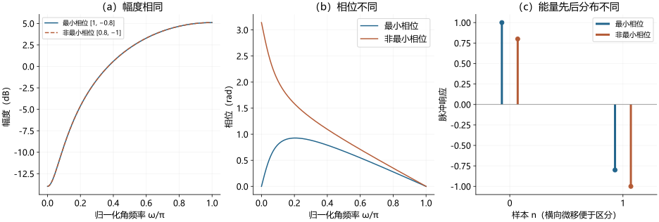
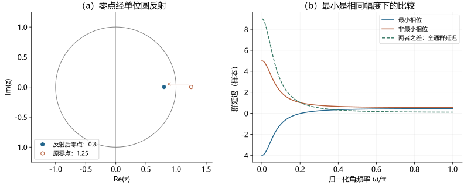
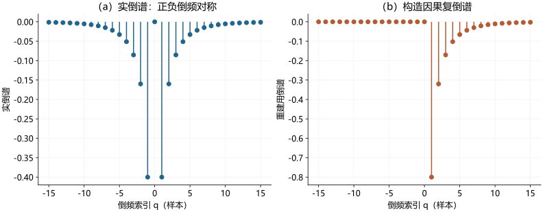
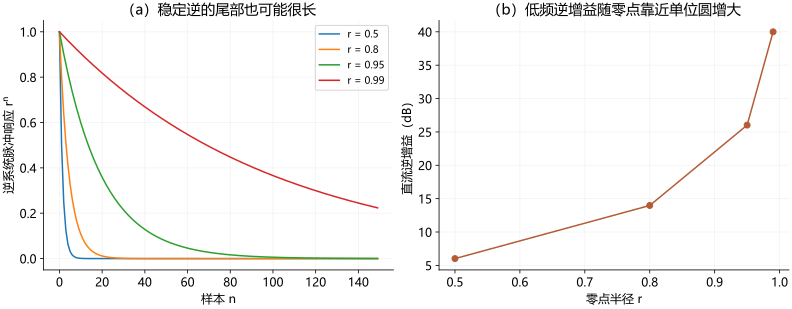

# 最小相位系统

> Minimum-Phase System · 深度词条 · 2026-10-29 · Draft，待专业审阅

解释最小相位系统的因果稳定逆、零点条件、最小群延迟与能量前置性质，推导零点反射和全通分解，给出倒谱重建与数值检验，并讨论声学均衡、HRTF、助听器及听觉实验中的适用边界。

| 术语信息 | 内容 |
| --- | --- |
| 离散时间定义 | 系统与其精确逆均因果且BIBO稳定 |
| 有理系统条件 | 因果稳定、首项非零，有限零点严格在单位圆内 |
| 比较前提 | 最小群延迟与能量前置性质针对相同幅度响应的因果稳定系统 |
| 幅相联系 | 完整对数幅度谱在固定常数相位约定后确定最小相位响应 |
| 应用限制 | 稳定可逆不保证逆增益适当；传播延迟和双耳时间差需另行处理 |

**最小相位系统**（minimum-phase system）是一类具有特殊相位结构的线性时不变系统。在本文主要讨论的离散时间情形中，它与其精确逆系统都能以因果、稳定的方式实现：输出只依赖当前与过去的输入，有界输入不会产生无界输出。对适当表示的有理传递函数，这要求系统的极点和零点严格位于单位圆内，并且没有需要逆系统提前取得未来输入的纯延迟。[1](#ref-mp-smith-filters)

这一概念回答了声信号处理中的一个实际问题：**两个系统的幅度响应完全相同，为什么瞬态波形仍会不同？** 幅度响应说明各频率被放大或衰减多少，相位响应说明这些分量怎样重新组合。最小相位响应是相同幅度响应所允许的因果稳定实现中，能量最靠近起始时刻的一种；它还为幅度谱推算相位、构造均衡器和简化空间音频模型提供依据。[1](#ref-mp-smith-filters)[2](#ref-mp-smith-spectral)

“最小”有明确的比较条件，不能理解为相位处处等于零、总处理延迟最短或听感必然最好。尤其在[空间听觉](https://betterci.github.io/n3-hearingpedia/concepts/spatial-hearing/)中，传播与[双耳时间差](https://betterci.github.io/n3-hearingpedia/concepts/interaural-time-difference/)本身就是信息。把实测响应换成最小相位版本是一种模型选择，不能据此认定被去掉的时间信息无用。

## 从相同幅度、不同波形理解定义

对离散时间系统，记输入为 $x[n]$、脉冲响应为 $h[n]$，输出为卷积 $y[n]=(h*x)[n]$。样本索引 $n$ 为整数；采样率为 $f_s$ Hz 时，一个样本对应 $1/f_s$ s。系统频率响应写成

$$
H(e^{j\omega})=|H(e^{j\omega})|e^{j\phi(\omega)},\qquad \omega=2\pi f/f_s.
$$

这里 $\omega$ 的单位为 rad/sample，$f$ 为 Hz；$\phi$ 是以 rad 表示并在适当区间连续展开的相位。普通幅度谱没有保留 $\phi$，因此通常不足以确定 $h[n]$。这一点与[频谱及功率谱密度](https://betterci.github.io/n3-hearingpedia/concepts/spectrum-and-power-spectral-density/)中复频谱和功率表示的区别相连。

一个可逐项核算的教学例子是

$$
H_{\min}(z)=1-0.8z^{-1},\qquad H_{\mathrm{non}}(z)=0.8-z^{-1}.
$$

两者都是因果稳定的两抽头有限脉冲响应（FIR）系统，脉冲响应分别为 $[1,-0.8]$ 与 $[0.8,-1]$。在单位圆上直接求模平方，两者都得到 $1.64-1.6\cos\omega$，所以幅度响应严格相同。但是首样本能量分别为 $1$ 与 $0.64$，相位也不同。前者的零点为 $0.8$，后者的零点为 $1.25$；这使它们的逆系统具有不同的可实现性。这里的系数是无量纲教学设定，没有模拟特定耳朵或设备。

<figure class="encyclopedia-figure">

<figcaption><strong>图1　相同幅度不唯一决定时域波形。</strong>（a）两条幅度曲线重合；（b）同一复响应给出不同相位；（c）两组脉冲响应共享纵轴，绘图横向微移只为避免遮挡，实际索引均为0与1。总能量均为1.64，未分别归一化。原创解析教学计算，不是听觉实验结果；原理见文献<a href="#ref-mp-smith-filters">1</a>。</figcaption>
</figure>

## 因果、稳定和零点条件

### 为什么逆系统的要求会落到零点上

离散时间有界输入有界输出（bounded-input bounded-output，BIBO）稳定要求脉冲响应绝对可和。对于因果有理系统，这等价于全部极点严格位于单位圆内。把传递函数取倒数，原系统的零点成为逆系统的极点，因此零点也必须严格在圆内。还需检查逆系统是否因果：若原系统在输入后先等待若干样本，精确恢复原输入就需要向前移动时间。[1](#ref-mp-smith-filters)

对已约去公因子、且明确给出因果实现的

$$
H(z)=\frac{b_0+b_1z^{-1}+\cdots+b_Mz^{-M}}
{1+a_1z^{-1}+\cdots+a_Nz^{-N}},
$$

严格最小相位要求 $b_0\ne0$，以及全部有限极点、零点满足 $|p_k|<1$、$|z_k|<1$。首项条件不是排版细节：$H(z)=z^{-D}$ 的幅度恒为1，有限极点在原点，但它的逆 $z^D$ 是提前 $D$ 个样本，$D>0$ 时不能因果实现。只统计有限零点、忽略无穷远零点或显式延迟，会误判纯延迟。

上述两抽头例子中，$1/H_{\min}$ 的因果脉冲响应为 $0.8^n u[n]$，其中 $u[n]$ 是单位阶跃序列，可以绝对求和。$1/H_{\mathrm{non}}$ 若按因果递推展开，则包含按 $1.25^n$ 增长的项；若改取稳定的展开，则需要负时间项。它可以在因果性与稳定性中选取其一，却不能同时满足二者。原系统仍然稳定，问题发生在它的精确逆。

单位圆上的零点需要单独对待。例如差分器 $1-z^{-1}$ 在直流有零点，其逆是累加器，不能满足严格 BIBO 稳定。许多理想陷波或线性相位滤波器存在单位圆零点，工程材料有时把它们列入广义最小相位设计；本文的严格定义不包含这类边界情形。

### 连续时间的用语不能机械照搬

连续时间稳定有理系统要求极点在左半平面，常见“最小相位”用语还要求有限零点在左半平面。但若要进一步声称其精确逆也能作为因果、BIBO稳定的普通系统实现，还必须考虑相对阶次。最简单的低通 $H(s)=1/(1+sT)$，$T>0$，没有右半平面零点，却有逆 $1+sT$，其中微分项会无界放大高频，不能视为普通稳定均衡器。纯传播延迟的逆同样需要时间提前。[8](#ref-mp-inverse)

因此，下文的“因果稳定逆”和单位圆判据均以离散时间、标量、有理传递函数为主要范围；连续时间声路可借用分解思路，但需要额外的实现条件。约简传递函数还可能隐藏内部不稳定的抵消，实际实现应检查内部状态，不能只凭约简后的输入输出表达式作保证。

## 零点反射与最小相位—全通分解

### 反射必须同时调整增益

若一个零点 $\xi$ 位于单位圆外，令 $a=1/\xi^*$，其中星号为复共轭，则 $a$ 在单位圆内。单位圆上有恒等式

$$
|1-\xi e^{-j\omega}|=|\xi|\,|1-ae^{-j\omega}|.
$$

把零点替换为 $1/\xi^*$、并乘上 $|\xi|$，才能保留幅度；只移动零点会改变整体增益。实系数系统的非实零点成共轭对，反射也应成对完成，以保持实系数。对高阶系统，直接求根可能病态，计算上未必适合用这一概念操作来实现。[1](#ref-mp-smith-filters)

对图1的例子，零点 $1.25$ 反射为 $0.8$，并将增益调整到对应水平。原系统与最小相位系统之比是

$$
A(z)=\frac{H_{\mathrm{non}}(z)}{H_{\min}(z)}
=\frac{0.8-z^{-1}}{1-0.8z^{-1}},\qquad |A(e^{j\omega})|=1.
$$

这个 $A$ 是因果稳定的全通系统：它改变相位而不改变任何频率的幅度。它不是严格最小相位，因为零点在圆外。除去模为1的常数因子这种平凡情形，因果稳定全通的逆不能同时因果且稳定。

### 一般分解表达了哪些信息

没有单位圆零点的因果稳定有理系统，可以将圆外零点逐一反射，得到

$$
H(z)=H_{\min}(z)A(z)z^{-D}.
$$

$H_{\min}$ 保留原幅度，$A$ 表示余下的非平凡全通部分，整数 $D\ge0$ 表示另外提取的纯延迟。纯延迟也可以并入全通因子；显式列出只是便于区分滤波相位与传输等待。它们不是三个互不相关的实测量，延迟如何分配取决于采用的表示与参照。[1](#ref-mp-smith-filters)

由幅度重建得到的只有 $H_{\min}$，没有自动找回 $A$ 和 $D$。给定相同幅度，给系统再串联一个全通或延迟，幅度依旧不变。因此，仅有幅度测量无法证明一个未知声路本来就是最小相位，也无法恢复绝对飞行时间。

<figure class="encyclopedia-figure">

<figcaption><strong>图2　零点位置连接逆系统与延迟。</strong>（a）圆为单位圆；两点为相同幅度响应对应的零点。（b）群延迟以样本为单位，差值等于全通因子的非负群延迟。直流处最小相位、非最小相位及差值分别为−4、5和9样本。原创解析计算；负群延迟不表示系统能输出未知的未来输入。参见文献<a href="#ref-mp-smith-filters">1</a>及<a href="https://betterci.github.io/n3-hearingpedia/concepts/phase-and-group-delay/">相位延迟与群延迟</a>。</figcaption>
</figure>

## “最小”的群延迟与能量含义

### 群延迟最小不等于处处非负

[群延迟](https://betterci.github.io/n3-hearingpedia/concepts/phase-and-group-delay/)定义为 $\tau_g(\omega)=-d\phi/d\omega$；此处角频率为 rad/sample，所以结果是样本数，除以 $f_s$ 才得到秒。串联系统的连续相位相加，群延迟也相加。稳定因果有理全通的群延迟非负，于是上述分解给出

$$
\tau_{g,H}(\omega)=\tau_{g,\min}(\omega)+\tau_{g,A}(\omega)+D
\ge\tau_{g,\min}(\omega).
$$

这是在幅度响应相同、系统因果稳定、所比较频率响应非零并可求导等条件下的逐频结论。它没有比较不同幅度指标的滤波器，也没有包含处理器缓存、分帧和音频接口的额外等待。[1](#ref-mp-smith-filters)

本例的全通群延迟可直接算为

$$
\tau_{g,A}(\omega)=\frac{1-r^2}{1+r^2-2r\cos\omega},\qquad r=0.8.
$$

它处处为正。但是最小相位部分在直流处的群延迟为 $-r/(1-r)=-4$ 样本。负值来源于滤波对波形的重塑，而非因果性被打破：输出递推仍然只使用当前与过去的输入。因而，“最小相位一定具有非负群延迟”和“负群延迟意味着非因果”都不成立。

### 能量最靠前是累计量的比较

在本文的有理系统范围内，对具有相同幅度谱的因果、稳定脉冲响应，最小相位版本满足

$$
\sum_{n=0}^{K}|h_{\min}[n]|^2
\ge\sum_{n=0}^{K}|h[n]|^2,\qquad K=0,1,2,\ldots
$$

相同幅度谱使总能量相同；上式表示任意初始区间内，最小相位响应已经积累的能量至少一样多。它比较的是前缀能量，不要求每个样本幅度都单调下降，也不要求最大样本必在 $n=0$。复杂共振器仍可能有振荡与长尾。[1](#ref-mp-smith-filters)

图1中，$K=0$ 时的能量为1与0.64；$K\ge1$ 时两者都已达到1.64。两者首个非零样本都在0，单看“起始潜伏期”无法区分。若乘上任意足够小的正增益，两者绝对能量都会减小，但最小相位的判定不变：这是系统结构性质，不是某个绝对能量阈值。

“能量最靠前”也不能直接当作知觉结论。它可能帮助降低滤波等待或改变瞬态前后振铃，但是否可察觉、是否更自然，仍取决于刺激与任务。数学上的极小性质不自动给出音质排序。

## 对数幅度为何能决定最小相位

一般响应的实部与虚部不能用幅度直接互推。最小相位的特殊之处在于，可以选取相容的复对数

$$
\log H_{\min}(e^{j\omega})=\ln|H(e^{j\omega})|+j\phi_{\min}(\omega),
$$

并使其对应的复倒谱具有因果结构。其对数幅度和相位因此满足 Hilbert 变换关系。若采用周期 Hilbert 算子使 $\mathcal H_p\{\cos(k\omega)\}=\sin(k\omega)$，则有

$$
\phi_{\min}(\omega)=-\mathcal H_p\{\ln|H(e^{j\omega})|\}+\phi_0.
$$

符号依赖变换定义，不能把另一种约定中的正负号直接抄来。这里使用自然对数幅度，式中的 $k$ 为正整数；若输入是功率谱，应先取平方根或用半对数。直接把 dB 数值代入而不换算，也会改变结果。[2](#ref-mp-smith-spectral)

常数相位 $\phi_0$ 需要另定。对实系数系统，可采用 $h_{\min}[0]>0$ 的规范；幅度本身无法区分 $h$ 与 $-h$。因此，“幅度唯一确定最小相位”隐含完整频带、适当的非零与正则条件，以及常数相位或符号约定。纯延迟仍不由幅度确定，不能把它当成可随意加入的最小相位自由度。

可以用 $H_{\min}=1-rz^{-1}$ 独立检验符号。对 $|r|<1$，展开得 $\log(1-rz^{-1})=-\sum_{k\ge1}r^kz^{-k}/k$；其对数幅度包含 $-r^k\cos(k\omega)/k$，相位包含 $+r^k\sin(k\omega)/k$。它们正好符合上式。这一检查也说明为什么零点越接近单位圆，倒谱衰减越慢，有限长度计算越困难。

这里的 Hilbert 变换沿**频率轴的对数幅度**进行，与为一个时间波形构造解析信号、提取[时域包络](https://betterci.github.io/n3-hearingpedia/concepts/temporal-envelope/)的操作不同。两种方法共享数学工具，但输入变量、输出含义和适用条件都不同。

## 从实倒谱重建与实现检查

### 有限DFT算法

[实倒谱](https://betterci.github.io/n3-hearingpedia/concepts/cepstrum/)舍弃原相位，却可用于构造与幅度相容的最小相位候选。对实输入、偶数 DFT 长度 $N$，记幅度采样为 $M[k]>0$，计算

$$
c_r[q]=\operatorname{IDFT}\{\ln M[k]\}.
$$

DFT 的后半区在这里代表负倒频。构造用于重建的因果倒谱

$$
c_{\min}[q]=
\begin{cases}
c_r[0],&q=0,\\
2c_r[q],&1\le q<N/2,\\
c_r[N/2],&q=N/2,\\
0,&N/2<q<N.
\end{cases}
$$

然后取 $H_{\min}[k]=\exp(\operatorname{DFT}\{c_{\min}\})$，再逆变换得到重建序列。零倒频与偶数长度的折返点不能翻倍，奇数长度则没有该折返点，窗口需相应改变。此算法由实倒谱重建一个指定的相位结构，并没有从输入中重新发现已丢失的原始相位。[3](#ref-mp-rceps)

<figure class="encyclopedia-figure">

<figcaption><strong>图3　从双侧实倒谱构造因果复倒谱。</strong>输入为[0.8, −1]，DFT长度4096，显示−15至15样本的倒频区间。（a）实倒谱对称；（b）重建用倒谱将正倒频加倍，保留零倒频。重建前两项为[1, −0.8]，数值残差见复现记录。原创教学计算，原理与窗口依据文献<a href="#ref-mp-rceps">3</a>；有限DFT不意味着任意截断后的滤波器仍严格满足圆内零点条件。</figcaption>
</figure>

### 计算正确还要检查哪些条件

实测幅度可能有零值、噪声底或极深凹口，使对数发散。常用处理是 $\ln\max(M[k],\epsilon)$，其中 $\epsilon$ 是与归一化方式一致的幅度下限。但这改变了目标幅度，是正则化选择，应报告其数值与单位。若根据测量噪声决定下限，应同时保留噪声估计方式；不能把所有微小幅度都当成精确信息。

算法需要覆盖离散时间完整频率周期。实系统可以由0至奈奎斯特频率的幅度构造偶对称谱，不能把20 Hz至20 kHz等任意截取片段直接当作一个完整周期。FFT沿均匀频率采样工作，对数频率网格需先作有说明的重采样和频带外补全。频带外假设会影响带内相位，窄带测得的幅度不足以唯一约束整条曲线。

有限 DFT 把倒谱看成周期序列，会出现环绕与混叠。增加 FFT 长度通常能减少相应数值误差，却不会补回未测得的频率或修正错误的幅度估计。把长序列截成短 FIR 又会改变幅度和零点位置，因此应在最终实现上复核，而不是只核对截断前的频率样本。

SciPy 的 `minimum_phase` 是线性相位 FIR 的转换工具。官方文档区分 `half=True`（默认）的约半长度、目标幅度约为原幅度平方根，与 `method='homomorphic', half=False` 的同长度、目标匹配原幅度。若要做“同幅度相位比较”，不能忽略该参数；其 `hilbert` 选项也有针对特定等波纹设计的条件。[4](#ref-mp-scipy)

本词条的生成脚本直接用上述倒谱窗恢复两抽头例子，并与解析系数比较，没有把任意脉冲响应送入一个不符合输入要求的接口。独立数值检验同时检查幅度误差、全通模值、群延迟差和重建尾部能量；这些是计算一致性检查，不能替代声路模型或听觉有效性的验证。

## 逆滤波与声学均衡

最小相位系统有稳定因果逆，使其适合描述可在线抵消的幅相畸变。但**存在稳定逆，不等于使用精确逆一定合理**。对 $H(z)=1-rz^{-1}$，$0<r<1$，逆的直流增益为 $1/(1-r)$。当 $r=0.99$ 时，理论逆仍稳定，直流增益却达到100，即40 dB，尾部也衰减很慢。这会放大测量误差、背景噪声与模型失配。

<figure class="encyclopedia-figure">

<figcaption><strong>图4　稳定可逆与良好条件性是两回事。</strong>（a）同一单位脉冲输入下，逆响应rⁿ随半径增加而延长；（b）r为0.5、0.8、0.95、0.99时的直流逆增益。横轴与增益来自独立解析设定，未分别归一化，也不是均衡器推荐参数。图中增益只代表这一模型的直流点，不能解释为所有频率的统一放大量。</figcaption>
</figure>

对含非最小相位部分的 $H=H_{\min}Az^{-D}$，只用 $1/H_{\min}$ 均衡后，理论剩余为 $Az^{-D}$，幅度可平坦，但余下相位与延迟仍存在。不能把这种结果描述为完整恢复原输入。有限延迟可以帮助近似非因果逆；一般也不能把需要无限未来信息的稳定逆变成精确的有限等待实现。

一种可说明权衡的频域正则化教学形式是

$$
G_\lambda(e^{j\omega})=
\frac{H^*(e^{j\omega})}{|H(e^{j\omega})|^2+\lambda(\omega)},\qquad \lambda(\omega)>0.
$$

这里将响应归一化为无量纲，$\lambda$ 与幅度平方同尺度。它通过牺牲精确反演抑制深凹口处的过度增益；单凭这个频域公式并不保证因果、短长度或低等待，实际还需选择时移、窗和实现结构。它是解释正则化的解析例子，并非某款设备算法或临床处方。

在[房间声学](https://betterci.github.io/n3-hearingpedia/concepts/room-acoustics/)中，多路径反射可能产生混合相位响应，而且测量位置稍变，干涉凹口就会变化。因此，一个位置的精确反演不等于整个区域都得到改善。对[电声换能器](https://betterci.github.io/n3-hearingpedia/concepts/electroacoustic-transducer/)和耳机也需要同时看可用动态余量、声路重复性与目标频带；将某段响应拟合成最小相位，是明确适用范围的工程近似。

## HRTF、双耳线索与听觉行为

### 最小相位加延迟需要保留什么

头相关传递函数（head-related transfer function，HRTF）描述声源到耳部测量位置的幅相变换。常见近似把左右耳分别写为 $H_L\approx H_{L,\min}e^{-j\omega D_L}$ 与 $H_R\approx H_{R,\min}e^{-j\omega D_R}$。这可以把方向相关幅度与额外时间对齐分开表示，但 $D_L,D_R$ 的差异并不自动等于完整低频双耳时间线索：两个最小相位因子也各自产生频率相关相位，延迟应结合整体响应选择。

Kulkarni等1999年研究用修改相位的HRTF开展四间隔二选一辨别，并分析最低频段的时间线索。摘要报告，最小相位加延迟近似的有效性依赖低频ITD是否合适；结果限制在消声条件、持续几毫秒的短脉冲响应，不能泛化为任意混响声场或“人耳不敏感于相位”。部分位置的双耳辨别表现高于随机，正提醒读者要检查具体线索。[5](#ref-mp-kulkarni-1999)

2004年的后续HRTF建模工作研究有理滤波器加简单延迟，并讨论全极点与极零模型。它说明零极点表达可用于压缩和拟合空间滤波；并不证明所有人的所有方向响应都具有相同相位结构。[6](#ref-mp-kulkarni-2004)

若把左右耳脉冲峰分别移到零时刻，又没有保存相对时移，就可能消除或改变声源方向信息。双耳处理必须有共同时间参照，并同时检查重建后的频率相关耳间相位、ITD和幅度差。单耳幅度拟合得很好，不足以保证正确定位、外化或动态头动体验。

### 数学相位差需要怎样的听测

Liski等2021年用数字全通滤波改变群延迟、保持幅度，以耳机ABX任务比较四种刺激。作者摘要明确报告可察觉性依赖刺激类型与相对延迟变化的方向。这给“同幅度、不同相位”的研究提供了直接行为范式，也说明不能用一个通用阈值决定所有设备中的相位处理。[7](#ref-pd-liski-2021)

对[助听器](https://betterci.github.io/n3-hearingpedia/concepts/hearing-aid/)而言，最小相位滤波可能减少同幅度目标下的滤波延迟，但分帧、缓冲、反馈控制以及开放验配中直达声与处理声的叠加仍需单独评估。对耳蜗及神经响应，线性时不变近似还有声级与状态限制；测得一条类似最小相位的响应，也不能直接证明其底层生物机制具有可实现的稳定逆。

## 测量、验证与研究设计

验证未知声路是否适合最小相位近似，应从同一参照下的复频率响应或脉冲响应出发。可采用宽带激励或扫频测量，并记录采样率、激励声级、输入输出同步、声源与接收位置及时间窗。若系统存在压缩、自适应或失真，先判断该工作点是否允许线性近似；不能把不同状态的幅度和相位拼成一个传递函数。

基本流程是从实测幅度构造 $H_{\min}$，再计算残余 $R=H/H_{\min}$。理想情况下残余模为1；拟合并移除明确的传播延迟后，检查剩余相位和群延迟。对深凹口附近，应结合信噪比屏蔽或降权，报告屏蔽范围。残余模值偏离1可能来自数值近似或不一致的幅度处理；模值接近1则说明幅度匹配，仍没有证明残余相位可忽略。

| 验证层次 | 建议报告 | 可以回答的问题 |
| --- | --- | --- |
| 数值实现 | 幅度误差、零点半径、FFT与滤波长度、截断误差 | 重建是否实现了指定目标 |
| 时间结构 | 共同参照、拟合延迟、剩余群延迟、前缀能量 | 近似删掉或移动了哪些时间信息 |
| 空间稳健性 | 位置与方向改变后的误差 | 模型能否推广到另一声路 |
| 双耳线索 | 低频ITD、耳间相位与幅度差 | 两耳关系是否得到保留 |
| 行为结果 | 刺激、任务、正确率或阈值及不确定性 | 指定差异在该条件下是否被听者利用 |

设计“最小相位与原相位”的听觉实验时，可在幅度相同基础上比较瞬态、语音和音乐，预先规定整体延迟对齐规则。若研究相位本身，应控制响度、削波、边界瞬态与播放链差异；若研究真实实时体验，则需要把实际延迟作为处理条件报告。辨别、偏好、定位和言语可懂度是不同结局，不能用ABX高于随机直接推断听感更差或言语理解下降。

本词条算例提供的是解析恒等式与数值复核，没有被试、实验误差线或临床结论。研究记录保存图源脚本、版本与检验残差；若将这些模型用于新的实测响应，应重新估计条件和误差，不能沿用教学参数作为合格标准。

## 理论脉络、常见误读与进一步阅读

最小相位把三个原本不同的问题联系起来：零点位置决定稳定逆，因果复对数连接幅度与相位，全通分解刻画相同幅度下多出的时间结构。倒谱算法将这种结构变成可计算的谱因子选择；HRTF和音频群延迟研究则进一步检验哪些被简化的相位差会成为行为线索。理论定理与知觉验证分别承担不同的证明任务。[1](#ref-mp-smith-filters)[2](#ref-mp-smith-spectral)[5](#ref-mp-kulkarni-1999)[7](#ref-pd-liski-2021)

仍需实际研究决定的问题包括：有限带宽与噪声下怎样选择幅度正则化；在听感、双耳同步和实时延迟之间怎样分配相位误差；个体HRTF近似在方向变化和混响中能保持哪些线索。它们不会仅凭“零点都在圆内”得到答案，也不能用某个数值重建误差替代行为验证。

| 常见说法 | 更准确的理解 |
| --- | --- |
| 幅度一样，输出就一样 | 还需要相位；图1给出可直接核算的反例 |
| 所有稳定FIR都是最小相位 | FIR稳定不约束其全部零点位置 |
| 最小相位就是零相位或线性相位 | 零相位是相位为零，线性相位强调相位随频率线性；最小相位强调因果稳定逆与同幅度下的极小性质 |
| 已知幅度便能恢复真实传播时延 | 幅度最多约束规范化最小相位候选，真实延迟需另测 |
| 最小相位可逆，所以深凹口应全部补平 | 逆可能具有巨大增益且对误差敏感 |
| 最小相位近似足够好，所以相位无听觉作用 | 结论依赖刺激、任务及保留的单耳和双耳线索 |

进一步阅读可从[相位延迟与群延迟](https://betterci.github.io/n3-hearingpedia/concepts/phase-and-group-delay/)理解延迟曲线，从[倒谱](https://betterci.github.io/n3-hearingpedia/concepts/cepstrum/)理解对数谱和重建，从[空间听觉](https://betterci.github.io/n3-hearingpedia/concepts/spatial-hearing/)与[双耳时间差](https://betterci.github.io/n3-hearingpedia/concepts/interaural-time-difference/)理解相位在定位中的作用，再结合[房间声学](https://betterci.github.io/n3-hearingpedia/concepts/room-acoustics/)区分传播、多径和均衡目标。

## 参考文献与证据范围

[1] Julius O. Smith III (2007). <a href="https://dsprelated.com/freebooks/filters/Minimum_Phase_Filters.html">Introduction to Digital Filters with Audio Applications — Minimum-Phase Filters</a>. W3K Publishing；作者在线教材 DSPRelated 镜像。访问范围：fulltext。阅读定义、零点条件、能量前置定理与最小相位/全通分解相关段落。本文算例和图为独立解析计算，不转载教材图片。

[2] Julius O. Smith III (2011). <a href="https://www.dsprelated.com/freebooks/sasp/Minimum_Phase_Filter_Design.html">Spectral Audio Signal Processing — Minimum-Phase Filter Design</a>. W3K Publishing；作者在线教材 DSPRelated 镜像。访问范围：fulltext。阅读对数幅度、相位、Hilbert关系与因果复倒谱解释；与前项为同一作者教材，不能当作独立实验重复证据。

[3] The MathWorks, Inc. (访问于2026-10-29). <a href="https://www.mathworks.com/help/signal/ref/rceps.html">rceps — Real cepstrum and minimum-phase reconstruction</a>. Signal Processing Toolbox 官方文档，R2026b。访问范围：documentation。核对实倒谱定义、倒谱窗与最小相位重建算法；有限DFT输出的边界由本文进一步说明。

[4] SciPy community (访问于2026-10-29). <a href="https://docs.scipy.org/doc/scipy/reference/generated/scipy.signal.minimum_phase.html">scipy.signal.minimum_phase</a>. SciPy 官方在线 API 文档（访问页面标示 v1.18.0）。访问范围：documentation。核对线性相位FIR输入、homomorphic/hilbert方法、FFT长度及half=True/False对长度和目标幅度的不同含义。本地执行版本另存。

[5] Abhijit Kulkarni; S. K. Isabelle; H. Steven Colburn (1999). <a href="https://pubmed.ncbi.nlm.nih.gov/10335633/">Sensitivity of human subjects to head-related transfer-function phase spectra</a>. The Journal of the Acoustical Society of America, 105(5), 2821–2840。访问范围：abstract。读取并在推送前直接打开PubMed页面复核摘要：四间隔二选一辨别、修改HRTF相位、低频ITD条件及仅限消声短响应的结论。访问范围为摘要，未声称取得全文。

[6] Abhijit Kulkarni; H. Steven Colburn (2004). <a href="https://pubmed.ncbi.nlm.nih.gov/15101650/">Infinite-impulse-response models of the head-related transfer function</a>. The Journal of the Acoustical Society of America, 115(4), 1714–1728。访问范围：abstract。读取摘要与书目：HRTF有理传递函数加延迟建模及全极点/极零模型比较；不复述未核实的阶数、误差或听测数值。

[7] Juho Liski; Aki Mäkivirta; Vesa Välimäki (2021). <a href="https://research.aalto.fi/en/publications/audibility-of-group-delay-equalization/">Audibility of Group-Delay Equalization</a>. IEEE/ACM Transactions on Audio, Speech, and Language Processing, 29, 2189–2201。访问范围：abstract。读取作者所在大学研究门户摘要及正式书目：全通操纵、四种刺激、耳机ABX与刺激/正负相对延迟变化的依赖性。未读全文，不将摘要阈值推广为听觉常模或助听器规格。

[8] The MathWorks, Inc. (访问于2026-10-29). <a href="https://www.mathworks.com/help/control/ref/inputoutputmodel.inv.html">inv — Invert dynamic system models</a>. Control System Toolbox 官方文档，R2026b。访问范围：documentation。核对逆系统及直通矩阵可逆条件。连续时间严格真有理系统的逆不一定可实现，正文用一阶低通独立推导说明。

