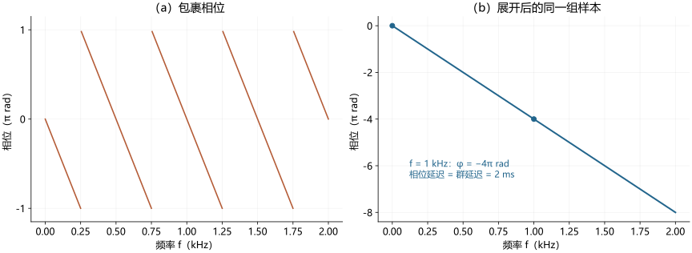
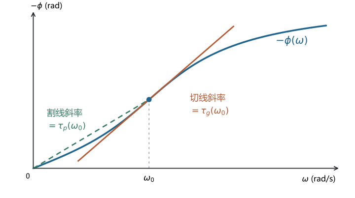
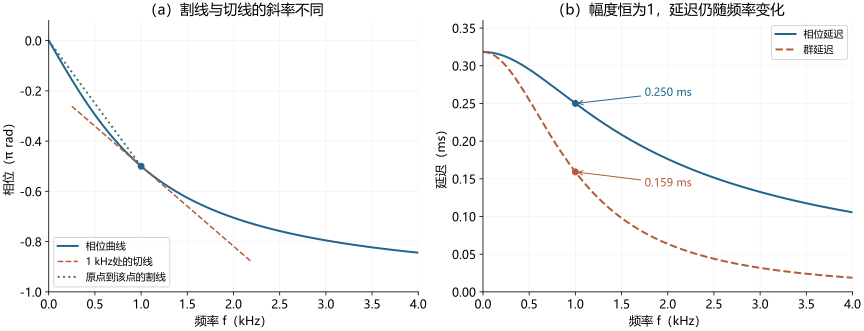
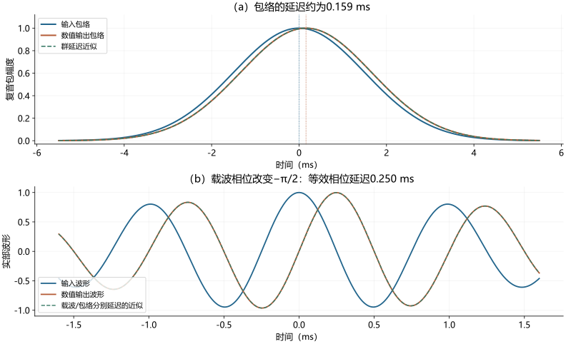
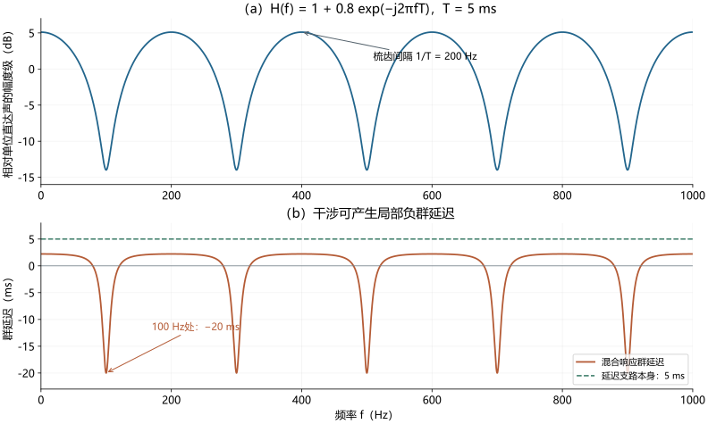

# 相位延迟与群延迟

> Phase Delay and Group Delay · 深度词条 · 2026-10-27 · Draft，待专业审阅

从相位响应解释相位延迟与群延迟，连接载波和包络、全通与线性相位滤波、相位展开及测量，并讨论耳声发射、助听器、双耳同步和神经记录中的用途与边界。

| 术语信息 | 内容 |
| --- | --- |
| 对象 | 系统复频率响应的相位随频率的变化 |
| 相位延迟 | 相位的负值除以角频率；依赖所选相位分支 |
| 群延迟 | 连续相位对角频率导数的负值 |
| 单位 | 以rad/s求导得秒；以rad/sample求导得样本数 |
| 直观解释 | 窄带且响应变化适当缓慢时，分别关联载波与包络 |

**相位延迟**（phase delay）与**群延迟**（group delay）是从系统相位响应定义的两种、通常随频率变化的时间量。相位延迟把某一频率的相位偏移换算为等效时间；群延迟由相位在该频率附近的变化斜率确定。在适当的窄带条件下，可以分别用它们理解载波的相位移动和包络的时间移动。两者对纯延迟系统相同，对一般滤波器则可能不同。[1](#ref-pd-smith-2007)[2](#ref-pd-mathworks-delay)

这一区别连接声音的[频谱](https://betterci.github.io/n3-hearingpedia/concepts/spectrum-and-power-spectral-density/)、[时域包络](https://betterci.github.io/n3-hearingpedia/concepts/temporal-envelope/)和[时域精细结构](https://betterci.github.io/n3-hearingpedia/concepts/temporal-fine-structure/)。只看幅度响应，不能完整判断系统怎样改变波形；测得一条相位斜率，也还需要知道输入参照、频率变量和系统条件，才能解释所得延迟。在听觉研究中，这些问题出现在[耳声发射](https://betterci.github.io/n3-hearingpedia/concepts/otoacoustic-emissions/)、电声器件、[助听器](https://betterci.github.io/n3-hearingpedia/concepts/hearing-aid/)以及实验信号的滤波处理中。

工程上，群延迟帮助回答一个直接问题：**组成信号的不同频带，经过处理后是否仍保持合适的相对时间关系？** 即使幅度响应符合设计目标，频率相关的延迟差异也可能改变音包、瞬态及多通道合成的波形。因而，工程设计既关心整体等待时间，也关心群延迟曲线的起伏和通道间差异；目标需结合波形保真、同步、算力与实时性确定。[2](#ref-pd-mathworks-delay)

本文以线性时不变系统为基本分析对象，即输入输出满足线性叠加、系统特性不随观察时间变化。真实耳蜗、动态压缩和自适应算法可能不满足这一假设；相关研究中的“延迟”需要结合刺激声级、工作状态和测量协议理解。相位延迟、群延迟、声音起始时刻、神经潜伏期与设备总处理时长，也各有不同的操作定义。

## 从纯音相位到时间延迟

### 正弦音怎样被延迟

设输入为 $x(t)=A\cos(2\pi ft)$，其中 $t$ 以秒计、$f$ 以赫兹计，$A$ 为幅度。理想系统将其完整推迟 $T$ 秒，输出为

$$
y(t)=x(t-T)=A\cos(2\pi ft-2\pi fT).
$$

所以，时间延迟对应一个随频率增长的相位滞后：$\phi(f)=-2\pi fT$。采用傅里叶变换核 $\exp(-j2\pi ft)$，$j^2=-1$，该系统的频率响应为 $H(f)=\exp(-j2\pi fT)$。这里明确变换约定，是为了固定公式中的负号。[1](#ref-pd-smith-2007)

作为教学例子，$T=2$ ms 时，250 Hz、500 Hz和1000 Hz的相位分别为 $-\pi$、$-2\pi$ 和 $-4\pi$ rad。三个正弦分量经历同一个时间延迟，累积相位却不同。因此，“各频率有相同相位偏移”和“各频率有相同时间延迟”描述的是不同关系。

### 单一纯音为什么不能确定完整延迟

一个无限持续的1000 Hz纯音每1 ms重复一次。若只观察稳态输入和输出，延迟0 ms、1 ms和2 ms会给出相同的相位角。相位可以确定周期内的位置，却无法单独告诉观察者已经经过多少个完整周期。声音起始、宽带探测、多个频率和已知声路等信息，可以帮助约束这一歧义。

软件通常将复数的相位角限制在 $(-\pi,\pi]$ 或类似区间内，称为**包裹相位**。**相位展开**通过增减 $2\pi$ 的整数倍，尝试得到随频率连续的相位曲线。展开结果还需与采样间隔、响应连续性及参照条件相容；它不能从缺失的信息中恢复任意多个周期。[1](#ref-pd-smith-2007)

<figure class="encyclopedia-figure">

<figcaption><strong>图1　同一个纯延迟的两种相位表示。</strong>（a）包裹相位在跨越边界处断开；（b）由同一组复数样本展开，频率从0开始并以零相位锚定，恢复2 ms延迟。频率步长5 Hz，1000 Hz处累积相位为−4π rad。原创解析教学图；连续直线来自指定的纯延迟模型，不代表任意实测响应都能可靠展开。<a href="#ref-pd-smith-2007">1</a></figcaption>
</figure>

## 两种延迟的定义、单位与相互关系

### 相位比值与局部斜率

在频率响应非零、相位可以局部连续且可微的频段，把系统写为

$$
H(\omega)=G(\omega)e^{j\phi(\omega)},\qquad
\tau_p(\omega)=-\frac{\phi(\omega)}{\omega},\qquad
\tau_g(\omega)=-\frac{d\phi(\omega)}{d\omega}.
$$

这里 $\omega=2\pi f$ 是角频率，单位rad/s；$G=|H|$ 是幅度响应；$\phi$ 是选定分支上的相位，单位rad；$\tau_p$ 和 $\tau_g$ 分别为相位延迟与群延迟，单位s。相位延迟的比值在 $\omega=0$ 处不能直接计算，只有在满足条件时才能以极限定义。[1](#ref-pd-smith-2007)[2](#ref-pd-mathworks-delay)

在相位—角频率图上，相位延迟是原点与曲线上一点之间的**割线斜率的负值**；群延迟是该点**切线斜率的负值**。一条通过原点的直线具有相同的割线与切线斜率，所以纯延迟系统的两种延迟都等于 $T$。弯曲的相位曲线则一般没有这一性质。

图2改用**负相位 $-\phi$** 作为纵轴，因此割线斜率直接等于 $\tau_p$，切线斜率直接等于 $\tau_g$；这里不再另取斜率的负值。读图时应先看纵轴究竟是相位还是负相位。

<figure id="secant-tangent-geometry" class="encyclopedia-figure">

<figcaption><strong>图2　从负相位曲线直接读取两种延迟。</strong>绿色虚线连接原点与指定频率ω₀处的点，橙色直线在该点与蓝色曲线相切。纵轴为−φ（rad）、横轴为ω（rad/s），故两种斜率的单位均为秒；本例两种延迟均为正。若纵轴改用φ，斜率标注应相应改为−τₚ与−τɡ。参考用户提供的割线/切线构图，独立用二阶全通响应绘制SVG；取固有角频率2π×1000 rad/s、阻尼比0.5、ω₀为固有角频率的0.85倍，省略数值刻度以突出几何关系，不代表设备或人耳常模。<a href="#ref-pd-mathworks-delay">2</a></figcaption>
</figure>

用频率 $f$（Hz）作为横轴时，公式为

$$
\tau_p(f)=-\frac{\phi(f)}{2\pi f},\qquad
\tau_g(f)=-\frac{1}{2\pi}\frac{d\phi(f)}{df}.
$$

若相位改用“周期数”，即 $\phi/(2\pi)$，对应公式中不再额外除以 $2\pi$；若相位用度，则须用360换算。纵轴用rad、横轴用kHz计算出的斜率，也应先处理1000倍的频率单位差异。

将 $\phi=-\omega\tau_p$ 求导，还可以得到

$$
\tau_g=\tau_p+\omega\frac{d\tau_p}{d\omega}.
$$

这说明群延迟同时涉及相位延迟的数值和它随频率的变化。两条延迟曲线无需在同一频率取得峰值，也不能简单把其中一条当作另一条的平均值。

### 相位分支与时间参照

若在一个连续频段内将相位整体加上 $2\pi k$，$k$ 为整数，群延迟不变，相位延迟却改变 $-k/f$ 秒。因此，为画图而把展开相位的首点任意平移到零，可以保留相位斜率，却不能继续用平移后的相位计算有原参照含义的相位延迟。

实际输入输出记录中的相对时间零点也很重要。若输出记录额外滞后 $T_0$，测得相位便额外含有 $-\omega T_0$，两种延迟均增加 $T_0$。共同移动输入输出的时间原点，与只移动其中一路，并不等价。报告“去掉设备延迟”时，应说明移除了哪个声学或数字参照之间的时间差。

### 数字系统的延迟何时是样本数

离散时间系统常以 $\Omega=2\pi f/f_s$ 表示数字角频率，单位rad/sample；$f_s$ 为采样率。此时 $D_g=-d\phi/d\Omega$ 的单位是样本，换成秒须计算 $D_g/f_s$。频率轴显示为Hz，并不保证函数返回的延迟也以秒计。[3](#ref-pd-scipy-group-delay)

例如，一个97抽头、96阶的对称线性相位有限冲激响应（FIR）滤波器，在响应非零处的群延迟为48个样本。在48 kHz采样率下，这是1 ms；同一组系数若改以24 kHz运行，延迟变为2 ms，频率响应对应的实际Hz坐标也随之改变。[2](#ref-pd-mathworks-delay) 本词条配套脚本在四个通带频点核对了48样本的结果。

## 为什么分别关联载波与包络

### “群”指一组相邻频率分量

群延迟中的“群”（group），指**集中在某个中心频率附近、共同叠加形成缓慢起伏或音包的一组频率分量**。它不是一群听者，也不是把所有频率的相位延迟取平均。关键是这些相邻分量之间的相位关系，如何决定叠加后包络的位置。[1](#ref-pd-smith-2007)

最简单的例子是两个幅度相同、频率接近的余弦。设 $\omega_1=\omega_c-\Delta\omega/2$、$\omega_2=\omega_c+\Delta\omega/2$，则三角恒等式给出

$$
\cos(\omega_1t)+\cos(\omega_2t)
=2\cos\left(\frac{\Delta\omega\,t}{2}\right)\cos(\omega_ct).
$$

右侧是慢变因子与快速载波的乘积；幅度包络取慢变因子的绝对值。这个持续拍音不是孤立的短音包，却能显示“相邻频率共同形成包络”的关系。加入更多适当幅度和相位的相邻分量，就可以形成局部集中的音包。

若系统在两个频率处的增益近似相同，并分别附加相位 $\phi_1$、$\phi_2$，略去共同增益，输出的慢变因子变为 $2\cos[(\Delta\omega\,t+\Delta\phi)/2]$，其中 $\Delta\phi=\phi_2-\phi_1$。与输入相比，它的时间移动量为

$$
\tau_{\mathrm{pair}}=-\frac{\Delta\phi}{\Delta\omega}.
$$

当两频率靠近同一中心频率、相位足够光滑时，这个差商趋于 $-d\phi/d\omega$，即群延迟。这也解释了为何要对相位**求导**：包络的位置由相邻分量之间的相位差决定，单个分量的相位比值不足以描述它。

### 从窄带音包理解群延迟

考虑以 $\omega_c$ 为中心的复数窄带信号 $z(t)=a(t)e^{j\omega_c t}$，其可播放的实信号为实部。$a(t)$ 是缓慢变化的包络，频谱集中在零频附近。设包络带宽内幅度响应近似为常数 $G_c$，相位可以作局部一次展开：

$$
\phi(\omega_c+\nu)\approx\phi(\omega_c)-\tau_g(\omega_c)\nu.
$$

$\nu$ 为偏离载波的角频率。将窄带内各分量相加后，得到近似输出

$$
z_{\mathrm{out}}(t)\approx
G_c\,a\bigl(t-\tau_g(\omega_c)\bigr)
e^{j\omega_c\left[t-\tau_p(\omega_c)\right]}.
$$

包络按 $\tau_g$ 移动，载波相位按 $\tau_p$ 改变。这是“群延迟描述包络延迟”的条件化来源，而不是对所有波形峰值的通用定义。[1](#ref-pd-smith-2007)

可把音包想成一串逐渐变强、再逐渐变弱的振动：载波描述每次振动处在周期的什么位置，包络描述这一串振动什么时候最强。一般滤波后，这两个位置未必按同一个时间量移动。若强行用一个延迟将整个输出与输入重合，便可能对齐包络却错开振动，或者对齐某个波峰却错开包络。

### 为什么强调窄带，近似何时失效

**群延迟的数学定义本身不要求输入是窄带信号。** 窄带条件服务于更强的解释：用中心频率处的一个群延迟值，近似代表整个音包的包络移动时间。为此，该音包所占频带内的相位应接近一条直线，幅度响应也应变化较小，使这些分量能近似作为一个整体移动。

“窄带”取决于信号带宽相对于系统响应变化的尺度。即使两个音包具有相同带宽，其中一个位于平缓通带、另一个跨越陡峭共振或陷波，输出也可能很不同。若幅度在带内变化明显，包络形状会被重新加权；若相位曲率明显，各频率的局部延迟不同，也会造成展宽、偏斜或振铃。

从局部展开看，要求是被忽略的二阶及更高阶相位项在信号带宽内足够小，而不是规定所有声音必须低于某个固定的Hz带宽。“带宽相对于中心频率较小”有助于建立慢包络与快载波的表示，但是否能把滤波结果当成简单延迟，还取决于系统在这段频带内的变化。对于幅度平坦的纯延迟系统，线性相位关系在整个频带成立，宽带信号也可以被完整平移。

当局部近似失效时，中心频率处的群延迟仍可能是一个有定义的频域量，但已不足以概括整个输出的时间形状。应检查完整复频率响应及实际刺激经过系统后的波形，而非只比较两个包络峰值。对于语音和音乐这样的宽带信号，可以考察整条 $\tau_g(f)$ 曲线，分析不同局部频带的时间关系；解释某一频带的包络延迟时，再检查其局部近似是否成立。**强调窄带，不意味着群延迟只对窄带工程有用。**

## 纯延迟、线性相位、全通与零相位

### 线性相位还需要说明截距

若在一个连续频段内 $\phi(\omega)=\phi_0-\omega T$，则

$$
\tau_g=T,\qquad \tau_p=T-\frac{\phi_0}{\omega}.
$$

因此，恒定群延迟并不自动使相位延迟处处相同。只有相位截距和分支满足相应条件时，两者才同时等于 $T$。对实系数FIR，系数对称或反对称可形成广义线性相位结构；幅度零点处可能伴随相位跳变，不能对跨过零点的相位机械求导。一般FIR并非天然具有线性相位。[2](#ref-pd-mathworks-delay)

即使一个通带内群延迟恒定，幅度响应也可能改变声音的频谱和包络。对任意输入都只产生固定增益与完整时间平移，要求相关频带内的幅度和相位共同满足相应条件。“线性相位”只约束相位这一部分。

### 全通系统：幅度不变，时间形状可以改变

**全通系统**的幅度响应在各频率保持不变，单位增益全通的幅度为1，其相位仍可随频率变化。对一般系统，只知道幅度不足以唯一确定相位；在适当的因果稳定条件下，可以将其分解为最小相位部分及全通部分。对常见离散时间有理系统，**最小相位**要求系统及其逆系统均为因果稳定；在相同幅度响应的相应因果稳定系统类中，它具有最小群延迟，但不等于零延迟。识别这类性质需要系统条件，不能仅凭幅频曲线是否平滑。[1](#ref-pd-smith-2007)

下面给出本词条独立计算的连续时间一阶全通例子：

$$
H(\omega)=\frac{a-j\omega}{a+j\omega},\qquad a>0,
$$

其中 $a$ 的单位为rad/s。分子分母模长相同，故 $|H|=1$；选择从直流零相位连续延伸的分支，有

$$
\phi(\omega)=-2\arctan\frac{\omega}{a},\quad
\tau_p=\frac{2\arctan(\omega/a)}{\omega},\quad
\tau_g=\frac{2a}{a^2+\omega^2}.
$$

取 $a=2\pi\times1000$ rad/s，在1000 Hz处，$\phi=-\pi/2$，$\tau_p=0.250$ ms，$\tau_g\approx0.159$ ms。这个系统保持各频率幅度，却改变不同频率之间的相位关系，所以短音包的细节可以变化。这里的参数仅服务于教学，不是听觉滤波器拟合或设备推荐值。

<figure class="encyclopedia-figure">

<figcaption><strong>图3　全通系统中的相位延迟与群延迟。</strong>（a）相位曲线、原点割线和1000 Hz处切线；（b）由同一个解析响应计算的两条延迟曲线。系统参数a=2π×1000 rad/s，幅度恒为1。原创数学教学图，图中割线与切线均以频率为横轴，换成秒时使用2π因子；图不提供可察觉性阈值。</figcaption>
</figure>

<figure class="encyclopedia-figure">

<figcaption><strong>图4　把两种延迟放回同一个音包。</strong>（a）输入复音包的模、图3系统的数值输出模，以及群延迟近似；（b）实部波形的时间局部放大。载波1000 Hz，高斯包络标准差1.5 ms；采样率192 kHz，32768点长记录，尾部近零，使用连续时间解析频响作FFT数值计算。近似与数值输出的相对L2误差约0.49%，没有分别归一化输出。包络图与波形图的时间范围不同；波形峰值还受包络影响，0.250 ms指载波相位的等效移动。</figcaption>
</figure>

### 零相位并不消除时间扩散

非平凡零相位滤波通常通过非因果处理实现。例如，对实系数滤波器作理想前后向处理，内部稳态等效响应为 $H(\omega)H^*(\omega)=|H(\omega)|^2$，相位为零，但幅度响应成为原幅度的平方。有限记录还涉及端点延拓与初始状态，端点瞬态不能只用这一理想公式描述。[4](#ref-pd-scipy-filtfilt)

零相位响应可以在事件前后分配能量。另一个常见实现是将线性相位FIR的输出向前移动以补偿固定延迟，它也使用相对于当前时刻的未来数据，且不等同于前后向滤波。离线时间轴上的对齐与实时系统需要等待多少数据，必须分别说明。[5](#ref-pd-mne-filtering)

## 怎样测量、展开和估计

### 先规定输入输出与工作状态

对于可近似为线性时不变的电声链，可用扫频、宽带噪声或适当探测信号测得复频率响应。在输入有足够能量的频点，理想无噪声关系是 $H(f)=Y(f)/X(f)$；实测时应根据输入输出噪声、重复记录与估计器选择评估可靠性。分析前需记录输入采样点、输出测量位置、时钟及触发参照。

一种代表性测量方案是Farina在2000年提出的指数扫频方法，研究对象为弱非线性、近似时不变系统，并与最大长度序列（maximum-length sequence，MLS）方法比较验证，应用涉及扬声器、电声器件及房间声学。[17](#ref-pd-farina-2000) 采用某种探测信号并不会自动保证测量符合假设，还需检查系统在记录期间是否改变、是否发生过载，以及所得响应包含哪些成分。

扬声器到传声器的声传播、数模与模数转换、数字缓冲及滤波均可能进入所测相位。若研究的是整条链，这些都属于测量对象；若只研究某个处理模块，就需要单独测定并处理其余部分。只在测量软件里执行“自动对齐”，可能同时去掉想要研究的真实固定延迟。

对压缩、降噪或反馈抵消等时变非线性处理，同一设备在不同输入电平、刺激历史或工作状态下可能给出不同响应。较合理的做法是固定或描述工作状态，比较适用条件下的响应，并同时记录短时波形和总体处理延迟；一条平均群延迟曲线无法涵盖所有动态行为。

### 频率间隔、相位展开与零点

对理想纯延迟，相邻频点相位差为 $-2\pi T\Delta f$。若只依赖常见的“相邻相位变化小于π”展开准则，一个充分的无噪声条件是 $\Delta f<1/(2T)$。例如，5 ms延迟对应频率间隔应小于100 Hz。它只是这个模型下的采样条件；加入噪声、陡峭共振和响应零点后，仍需更多检查。

幅度接近零时，相位往往很不稳定；幅度严格为零时，相位本身无定义。应在明确的信噪比、幅度或重复性条件下划定有效频段，并标记缺失区间。跨过缺失带强制接成一条平滑相位线，可能制造并不存在的延迟结构。数字滤波器软件在奇点处有时会报警并返回0，该数值不能解读为“系统恰好没有延迟”。[3](#ref-pd-scipy-group-delay)

### 数值求导与局部拟合

对等间隔频率样本，可以用中心差分估计群延迟：

$$
\widehat{\tau}_g(f_k)=
-\frac{\phi(f_{k+1})-\phi(f_{k-1})}{4\pi\Delta f}.
$$

相位须以rad计、$\Delta f$ 以Hz计，结果才是秒。非等间隔、对数频率采样或以kHz储存的数据，都要使用实际频率坐标。若只在对数频率轴上求斜率，还需用链式法则转换，不能直接套用上式。

求导会放大相位误差。作为独立的误差传播算例，若参与差分的两点具有独立、零均值、标准差 $\sigma_\phi$ 的小相位误差，且已排除展开错误，则延迟标准差为 $\sqrt{2}\sigma_\phi/(4\pi\Delta f)$。设 $\sigma_\phi=0.05$ rad、$\Delta f=10$ Hz，得到约0.56 ms。增加频率密度并不会在每点噪声不变时自动改善这种逐点差分估计。

可在一个频率窗内拟合 $\phi(f)\approx\alpha+\beta f$，以 $-\beta/(2\pi)$ 估计局部群延迟。较宽拟合窗通常降低随机波动，却可能掩盖真实曲率；权重与剔除准则也会改变结果。应报告窗宽、拟合模型、频点选择及重复测量，并核查残差，而不是把光滑程度当成准确度。在耳声发射中，固有源干涉还会产生真实的相位波动，平滑可能造成系统偏差。[11](#ref-pd-shera-bergevin-2012)

## 两路径叠加与负群延迟

### 延迟支路与混合响应是不同对象

设同一声音一条路径直接到达，另一条以相对幅度 $b$、额外延迟 $T$ 到达：

$$
y(t)=x(t)+b\,x(t-T),\qquad
H(f)=1+b\,e^{-j2\pi fT}.
$$

这是理解开放式助听器声路和早期反射的简化模型。令 $b$ 为实数正值，便有

$$
|H|^2=1+b^2+2b\cos(2\pi fT).
$$

相长与相消交替形成梳状幅度响应，重复间隔为 $1/T$。直接对上述复响应求导，得到本模型的群延迟

$$
\tau_g(f)=T\,
\frac{b^2+b\cos(2\pi fT)}{1+b^2+2b\cos(2\pi fT)}.
$$

取 $b=0.8$、$T=5$ ms，梳齿间隔为200 Hz。在100 Hz处，两路径接近相消，混合幅度为0.2，群延迟为−20 ms；延迟支路本身依然只具有正的5 ms延迟。此处混合响应的局部相位斜率，显然不能当作某条路径的传播时长。

<figure class="encyclopedia-figure">

<figcaption><strong>图5　干涉产生的群延迟与路径延迟。</strong>（a）两路径混合幅度，相对于单位直达路径的幅度级，未经峰值归一化；（b）混合群延迟与延迟支路本身的5 ms作比较。100 Hz陷波处混合响应仍非零，群延迟为−20 ms。原创解析教学图；无真实耳道、频率相关泄漏、压缩或房间混响，不能据此判定设备音质或人耳可察觉性。</figcaption>
</figure>

### 负值为什么不意味着信息提前到达

上述系统是因果的：它只使用当前输入和过去输入。如果输入在 $t=0$ 前严格为零，输出在此前也严格为零。负群延迟来自窄带分量相加后的局部相位结构；它可以关联某些缓变波形特征的重塑和前移，却不会让一个尚未进入系统的新事件提前出现。

这一解释还提示应区分**绝对负群延迟**与**相对于基准延迟的负变化量**。例如，两条处理链的延迟分别为10 ms和9 ms，后一条相对前者是−1 ms，但两者均具有正的绝对延迟。阅读群延迟均衡的听觉实验时，应先核对基准、是否补偿整体延迟及所谓“负峰”的定义。[8](#ref-pd-liski-2021)

## 耳蜗、耳声发射与调谐

### 延迟包含滤波建立过程

[耳蜗](https://betterci.github.io/n3-hearingpedia/concepts/cochlea/)的机械响应同时具有频率选择性、相位积累和声级依赖性。某个频率附近的群延迟既可能包含沿途传播，也可能反映局部滤波建立过程；若没有明确模型，不能把全部延迟都换成传播距离。行为估计的[听觉滤波器](https://betterci.github.io/n3-hearingpedia/concepts/auditory-filter/)、局部机械响应和耳道测得的发射响应，也不是同一个传递函数。

Shera与Guinan在2003年用猫、豚鼠和人的刺激频率耳声发射（stimulus-frequency otoacoustic emission，SFOAE）延迟检验相干反射理论；研究显示耳蜗基底端与顶端的对应关系需要分别考虑。[9](#ref-pd-shera-guinan-2003) 2010年的工作进一步用龙猫听神经及耳声发射资料检验调谐—延迟关系，并通过跨物种调谐比假设估计人类调谐。[10](#ref-pd-shera-tuning-2010) 这些证据支持延迟作为非侵入性线索的价值，同时保留从观测到机制的模型环节。

### 发射相位梯度的参照和源混合

在耳声发射（otoacoustic emission，OAE）文献中，phase-gradient delay按数学操作通常属于相位导数所定义的延迟，与本文的相位比值 $-\phi/\omega$ 应加以区分；阅读标题中的“phase delay”时也应核对作者实际使用的公式。

SFOAE通常相对于探测刺激计算相位。畸变产物耳声发射（distortion-product otoacoustic emission，DPOAE）还涉及原音组合相位及扫频路径：固定 $f_1$、固定 $f_2$ 和固定频率比可以得到不同相位导数。非线性组合产物并不天然等同于一个固定线性系统对单一输入频率的响应。[12](#ref-oae-delay-paradigms-2000) 具体协议和坐标换算见[耳声发射词条](https://betterci.github.io/n3-hearingpedia/concepts/otoacoustic-emissions/)。

发射通常由多个成分叠加，幅度谷与相位急变可以源于真实干涉。Shera与Bergevin在2012年用模型比较六种延迟趋势估计策略，发现相位平滑等方法可能产生偏差，也讨论了多重内部反射的分离。[11](#ref-pd-shera-bergevin-2012) 因而，曲线起伏既不能全部归为噪声，也不能未经成分分析就解释成局部组织传播速度变化。

### 调谐与延迟的对应不是固定换算表

2024年，Xia等通过耳蜗模型改变微观参数和刺激声级，检验SFOAE延迟与调谐锐度的对应。某些参数改变造成明显调谐展宽，却只伴随中等幅度的延迟缩短；由延迟估计调谐的准确性因模型条件而异。[16](#ref-pd-xia-2024) 这是模型中的边界检验，不是对某项临床诊断的直接验证。

因此，解释某位受试者的OAE群延迟，应同时考虑声级、测量质量、成分分离、频率区域和所用模型。以周期数表示的延迟 $N=f\tau$ 是无量纲量，便于某些跨频率比较；它也没有自行消除这些条件差异。

## 电声系统、助听器与双耳同步

### 工程上为何同时关心延迟大小、起伏与匹配

工程系统处理的是有起伏、有起始、有多个频率分量的信号。除了幅度是否保留，还需要判断信号各部分在时间上如何重组。群延迟因此既是分析量，也是滤波器和处理链设计时的一个约束。[2](#ref-pd-mathworks-delay)

| 工程问题 | 群延迟分析帮助判断什么 | 还需一起检查什么 |
| --- | --- | --- |
| 滤波后的音包与瞬态保真 | 有效频带内不同局部频率群是否经历不同延迟，是否可能展宽或改变时间形状 | 幅度响应、完整相位、冲激响应及实际刺激输出 |
| 分析滤波器组、多路处理与合成 | 各通道的有效延迟是否匹配，叠加时是否保留预期的时间关系 | 交叠频带的相位与增益、采样时钟和合成方式 |
| 双耳或多声路同步 | 左右处理差异及直达声与处理声之间的相对时间关系 | 声路混合、频率相关声级、空间任务和听者表现 |
| 实时系统的等待时间 | 滤波本身增加了多少延迟，延迟是否随频率变化 | 帧缓冲、前视、转换接口及整机输入输出时延 |

对于波形保真，常见目标是让相关频带内的群延迟足够平坦，或使不同通道具有合适的相对延迟；对于实时交互，还希望整体等待时间足够小。这些目标需要共同权衡：一条平坦但整体很大的群延迟曲线，仍可能带来较长等待；一条数值较小却起伏明显的曲线，也不能自动保证波形保真。

在多路相加时，群延迟匹配也不等于相位已经完全对齐。两条相位曲线可以具有相同斜率而保留常数相位差，这仍可能改变相加结果。因此，工程上通常把群延迟与相位、幅度和实际波形一起检查；最终可察觉性及使用效果再由对应任务验证。

### 可测得的群延迟差异是否可听

电声链的群延迟差异可以通过全通处理在幅度大致不变时单独操纵。[Jens Blauert](https://betterci.github.io/n3-hearingpedia/concepts/jens-blauert/)与Laws在1978年比较电声系统群延迟偏差和心理声学可察觉性，指出所测偏差在部分情况下可接近察觉阈值，而多数低于阈值。[7](#ref-blauert-group-delay) 2021年Liski等用全通滤波和耳机ABX任务比较四种刺激，进一步显示可察觉性强烈依赖刺激及相对延迟变化的形状。[8](#ref-pd-liski-2021)

ABX任务中，听者先接触A、B，再判断X属于哪一种。若希望将差异归于相位或群延迟，应控制幅度响应、声级、总体起始时间及切换线索，并说明训练、重复次数和阈值定义。可察觉、偏好、音质和识别正确率是不同结局；一条曲线看起来起伏很大，并不能替代行为测量。

### 开放验配中的延迟与音色

开放验配使直接声与助听器处理声在耳道内相加，其影响同时取决于相对延迟和两条声路的频率相关声级。图5解释了最简两路径干涉，但实际声路还包括耳道传输、泄漏、增益和压缩。因此，“处理延迟较长”不能单独预测每位用户的体验。[14](#ref-pd-susonn-2024)

Súsonnudóttir等2024年用助听器模拟器测试10名正常听力者和20名轻中度感音神经性听损者，比较0、0.5、2、5和10 ms延迟；短延迟组总体更受偏好，频谱波纹辨别能力与延迟偏好有关。[14](#ref-pd-susonn-2024) 该发现涉及模拟声与所选任务，不能直接变成个体设备选择规则。

2026年的后续研究让24名轻中度听损者佩戴原型开放验配助听器，比较自声下0.5、5和10 ms。三条件成对偏好任务的组间两两差异在多重比较校正后未达显著；另外的问卷偏好评分支持0.5 ms优于10 ms，部分自声属性评分也有差异，频谱任务未能预测偏好。[15](#ref-pd-susonn-2026) 结果说明评价工具和聆听对象影响结论；它没有建立适用于所有用户和声场的延迟分界。

### 双耳更关心哪些相对差异

若左右两条线性处理链分别为 $H_L$ 和 $H_R$，其对耳间相位的附加影响为 $\phi_R-\phi_L$，对应的群延迟差为 $\tau_{g,R}-\tau_{g,L}$。相同的整体延迟可以在这一差分中抵消；左右频率相关处理不一致则可能改变[耳间时间差](https://betterci.github.io/n3-hearingpedia/concepts/interaural-time-difference/)线索。真实开放验配还需要对混合后的耳信号分析，不能只比较设备说明中的一个标称值。

Roth等在2024年发表的研究中，让13名正常听力者听单侧或双侧开放验配模拟，测量空间分离噪声中的言语接收阈值（speech reception threshold，SRT）。单侧延迟条件下表现受影响，而双侧相同延迟模拟中未见相同的SRT变化；研究没有测试真实助听器用户，听损也采用衰减模拟。[13](#ref-pd-roth-2024) 这一结果支持检查双耳差异的必要性，其推广范围仍受刺激、空间配置和模拟方式限制。

## 神经记录、实时处理与报告

### 群延迟不能直接代替神经潜伏期

[听觉诱发电位](https://betterci.github.io/n3-hearingpedia/concepts/auditory-evoked-potential/)和[脑电图](https://betterci.github.io/n3-hearingpedia/concepts/electroencephalography/)中的峰潜伏期，是按某个时域波形、事件零点与峰值规则测得的时间。群延迟则来自指定复响应的相位斜率。多个神经源、频率权重、平均方式及分析滤波都可能改变两者关系；不能把一个滤波器的群延迟，直接当作神经传导时间。

Widmann等的方法论文强调同时检查冲激响应、频率响应、滤波参数和因果性。[6](#ref-widmann-2015) 对因果线性相位滤波，固定延迟可以按条件处理，但波形仍可能被平滑；对零相位处理，时间轴上的净延迟为零也不能保证起始、峰形或事件前基线完整保留。[5](#ref-pd-mne-filtering)

### 模块延迟与整机等待时间

实时系统还涉及帧长、前视、缓冲、重采样、声学传播和接口同步。某个滤波模块在通带内的群延迟很小，并不意味着整机从输入到输出的等待时间也很小。反过来，整机增加一个固定缓冲，可能只使群延迟曲线整体上移，而不改变它随频率的相对起伏。

比较算法时，宜同时给出频率相关响应和以实际输入输出参照测得的整体时间指标。若后处理把声音文件前移以方便对齐，应另保留实时实现原本需要的等待时间；离线对齐后的波形不能自行证明设备能够实时提前输出。[4](#ref-pd-scipy-filtfilt)[5](#ref-pd-mne-filtering)

### 最少需要报告什么

| 项目 | 需要明确的内容 |
| --- | --- |
| 对象与工作状态 | 整机、模块、声路或生理响应；线性近似、声级、模式及自适应状态 |
| 时间与相位参照 | 输入输出位置、触发、时钟、极性，已去除的固定延迟和所用相位分支 |
| 坐标与单位 | Hz或rad/s、数字角频率、rad或周期；延迟为秒、毫秒或样本数 |
| 有效频带 | 输入能量、幅度零点、信噪比、重复性及缺失区间 |
| 计算方法 | 频率采样、展开规则、差分或拟合窗、平滑、权重及剔除条件 |
| 时域验证 | 实际刺激输出、冲激响应、前后振铃和边界处理；是否补偿延迟 |
| 行为结局 | 人群、材料、任务、对照、阈值或评分规则；可察觉、偏好与识别分别报告 |

## 研究线索与尚待解决的问题

群延迟研究逐渐将数学描述与听觉问题连接起来：电声研究检验相位差异何时可听；OAE研究尝试从相位梯度推断耳蜗调谐；现代助听器研究则关注处理声与直接声叠加后，不同听者在不同任务中的结果。这几条线索共享相位分析工具，却需要各自的测量定义和验证证据。

仍需解决的问题包括：怎样在低信噪比、相位零点和多源混合条件下估计可靠的局部延迟；怎样把耳蜗模型中的调谐—延迟对应推广到个体测量；以及怎样在保留声音质量、双耳线索和增强效果的同时管理实时等待时间。2024年的模型检验与2024—2026年的助听器研究表明，机制条件、实验材料和评价结局都值得独立核查。[16](#ref-pd-xia-2024)[14](#ref-pd-susonn-2024)[15](#ref-pd-susonn-2026)

## 参见与图源说明

可先从[纯音与复合音](https://betterci.github.io/n3-hearingpedia/concepts/pure-and-complex-tones/)理解相位和频率，再结合[时域包络](https://betterci.github.io/n3-hearingpedia/concepts/temporal-envelope/)、[时域精细结构](https://betterci.github.io/n3-hearingpedia/concepts/temporal-fine-structure/)和[听觉滤波器](https://betterci.github.io/n3-hearingpedia/concepts/auditory-filter/)阅读窄带解释。应用部分可继续阅读[耳声发射](https://betterci.github.io/n3-hearingpedia/concepts/otoacoustic-emissions/)、[助听器](https://betterci.github.io/n3-hearingpedia/concepts/hearing-aid/)、[耳间时间差](https://betterci.github.io/n3-hearingpedia/concepts/interaural-time-difference/)及[房间声学](https://betterci.github.io/n3-hearingpedia/concepts/room-acoustics/)。[声码器](https://betterci.github.io/n3-hearingpedia/concepts/vocoder/)和[时域限制编码器](https://betterci.github.io/n3-hearingpedia/concepts/temporal-limits-encoder/)也涉及分析滤波与通道同步。

五张图均由本项目独立编写的脚本生成，提供SVG与PNG；其中图2参考用户提供的构图，统一坐标与斜率符号后使用解析响应重新绘制。纯延迟、全通和两路径参数是教学设定，未拟合人耳或商业设备，也未重绘论文数据。复现脚本、依赖版本、计算误差与文献检索范围保存在本次研究记录中。词条为AI辅助草稿，文献核验及工程检查不代替具名专业审阅。

## 参考文献与证据范围

[1] Julius O. Smith III (2007). <a href="https://www.dsprelated.com/freebooks/filters/Phase_Group_Delay.html">Introduction to Digital Filters with Audio Applications — Phase and Group Delay; Allpass Filters; Minimum-Phase Filters</a>. W3K Publishing / 作者公开在线教材（DSPRelated镜像）。访问范围：fulltext。读取相位/群延迟定义、展开相位、窄带调制推导，并交叉阅读同书Allpass Filters和Minimum-Phase Filters章节。三章属于同一教材，不当作三项独立证据。本站全通、两路径及误差算例为自主推导和数值教学计算。

[2] The MathWorks, Inc. (访问于2026-10-27). <a href="https://www.mathworks.com/help/signal/ug/delay.html">Group Delay and Phase Delay</a>. Signal Processing Toolbox 官方文档。访问范围：documentation。核对两种延迟的定义、对称线性相位FIR的N/2样本群延迟及IIR示例。未沿用页面中对全部稳定IIR的概括；正文只描述常见滤波器和有效频带。

[3] SciPy community (访问于2026-10-27). <a href="https://docs.scipy.org/doc/scipy/reference/generated/scipy.signal.group_delay.html">scipy.signal.group_delay</a>. SciPy 官方API文档。访问范围：documentation。核对离散时间群延迟、频率坐标fs与返回延迟的样本单位，以及单位圆零极点处群延迟未定义而软件可能返回0的行为。生成脚本另记录本地SciPy 1.17.1实算结果，不把在线文档版本冒充执行版本。

[4] SciPy community (访问于2026-10-27). <a href="https://docs.scipy.org/doc/scipy/reference/generated/scipy.signal.filtfilt.html">scipy.signal.filtfilt</a>. SciPy 官方API文档。访问范围：documentation。读取前后向两次滤波、零相位、有效阶数、端点延拓与瞬态说明；正文幅度平方关系限定为实系数滤波器的理想内部稳态频率响应。

[5] MNE-Python developers (访问于2026-10-27). <a href="https://mne.tools/stable/auto_tutorials/preprocessing/25_background_filtering.html">Background information on filtering</a>. MNE-Python 官方方法教程。访问范围：documentation。阅读因果/非因果、线性相位延迟补偿、滤波时间扩散和低通问题相关段落；仅支持方法解释，不支持具体神经起始时间或临床结论。

[6] Widmann A, Schröger E, Maess B. (2015). <a href="https://pubmed.ncbi.nlm.nih.gov/25128257/">Digital filter design for electrophysiological data--a practical approach</a>. Journal of neuroscience methods, 250, 34-46。访问范围：abstract。电生理数字滤波的方法与伪迹；零相位不等于没有时间扩散。

[7] Jens Blauert; P. Laws (1978). <a href="https://doi.org/10.1121/1.381841">Group delay distortions in electroacoustical systems</a>. Journal of the Acoustical Society of America, 63(5), 1478–1483。访问范围：abstract。通过Crossref读取出版社摘要与正式书目：耳机扬声器非最小相位群延迟及心理声学可察觉性比较；未取全文，未抄传通用阈值表。用于研究领域和物理偏差与听觉差异的区分。

[8] Juho Liski; Aki Mäkivirta; Vesa Välimäki (2021). <a href="https://research.aalto.fi/en/publications/audibility-of-group-delay-equalization/">Audibility of Group-Delay Equalization</a>. IEEE/ACM Transactions on Audio, Speech, and Language Processing, 29, 2189–2201。访问范围：abstract。读取作者所在大学研究门户摘要及正式书目：全通操纵、四种刺激、耳机ABX与刺激/正负相对延迟变化的依赖性。未读全文，不将摘要阈值推广为听觉常模或助听器规格。

[9] Christopher A. Shera; John J. Guinan Jr. (2003). <a href="https://pubmed.ncbi.nlm.nih.gov/12765394/">Stimulus-frequency-emission group delay: a test of coherent reflection filtering and a window on cochlear tuning</a>. The Journal of the Acoustical Society of America, 113(5), 2762–2772。访问范围：abstract。阅读PubMed摘要：猫、豚鼠及人SFOAE群延迟，反射理论、耳蜗基底与顶端解释差异。只概括测量与模型检验，不据摘要推导个体常模或单程传播时长。

[10] Christopher A. Shera; John J. Guinan Jr.; Andrew J. Oxenham (2010). <a href="https://pubmed.ncbi.nlm.nih.gov/20440634/">Otoacoustic Estimation of Cochlear Tuning: Validation in the Chinchilla</a>. Journal of the Association for Research in Otolaryngology, 11(3), 343–365。访问范围：abstract。读取PubMed摘要并核对公开PMC索引中的物种比较讨论：龙猫听神经/OAE资料检验、人类外推的调谐比假设。PMC完整抓取失败，因此保守标为摘要访问，不声称逐段全文审阅。

[11] Christopher A. Shera; Christopher Bergevin (2012). <a href="https://pmc.ncbi.nlm.nih.gov/articles/PMC3427360/">Obtaining reliable phase-gradient delays from otoacoustic emission data</a>. The Journal of the Acoustical Society of America, 132(2), 927–943。访问范围：fulltext。经公开PMC网页读取摘要、引言、模型、数值求导及六种估计方法比较相关段落；反射源固有相位波动、相位平滑偏差与多重反射分离。模型研究，不能将某种峰值选择方法视为所有实测响应的通用标准。

[12] Tubis A, Talmadge CL, Tong C, Dhar S. (2000). <a href="https://doi.org/10.1121/1.1310666">On the relationships between the fixed-f1, fixed-f2, and fixed-ratio phase derivatives of the 2f1-f2 distortion product otoacoustic emission.</a>. The Journal of the Acoustical Society of America。访问范围：abstract。摘要支持固定 f1、固定 f2 与固定频率比的相位导数差别；正文 1.5 倍坐标换算是明确条件下的解析计算。

[13] Sebastian Roth; Franz-Ullrich Müller; Julian Angermeier; Werner Hemmert; Stefan Zirn (2024（卷号标为2023）). <a href="https://www.frontiersin.org/journals/neuroscience/articles/10.3389/fnins.2023.1257720/full">Effect of a processing delay between direct and delayed sound in simulated open fit hearing aids on speech intelligibility in noise</a>. Frontiers in Neuroscience, 17, 1257720；在线发表于2024-01-04。访问范围：fulltext。通过公开Europe PMC全文XML核对方法、结果和局限：13名正常听力者、单/双侧开放验配模拟、空间分离噪声SRT、衰减式听损模拟。正文不沿用摘要将SRT由负18.1至负14.7 dB误称decrease的措辞；不把模拟结论推广到真实助听器用户。

[14] Borgný Súsonnudóttir; Borys Kowalewski; Georg Stiefenhofer; Tobias Neher (2024). <a href="https://journals.sagepub.com/doi/10.1177/23312165241298613">Individual Differences Underlying Preference for Processing Delay in Open-Fit Hearing Aids</a>. Trends in Hearing, 28, 23312165241298613。访问范围：fulltext。读取出版社摘要及Europe PMC全文XML中参与者、助听器模拟、延迟条件、偏好与谱波纹任务结果：10名正常听力、20名轻中度感音神经性听损，五种延迟。频谱任务与偏好关系是特定模拟条件下的发现，不能直接当个体处方规则。

[15] Borgný Súsonnudóttir; Lars D. Mosgaard; Georg Stiefenhofer; Pamela E. Souza; Tobias Neher (2026). <a href="https://journals.sagepub.com/doi/10.1177/23312165261435260">Own-Voice Perception with Different Processing Delays in Open-Fit Hearing Aids</a>. Trends in Hearing, 30, 23312165261435260；在线发表于2026-03-23。访问范围：fulltext。读取出版社全文结果与Table 2、Table 5、Figure 6及Europe PMC全文XML：24名轻中度听损者、原型开放验配、自声，0.5/5/10 ms；区分三条件成对比较多重校正后不显著与问卷0.5/10 ms偏好评分显著，SRD未预测偏好。保留开放耳塞、实验室及增益条件限制。

[16] Yiwei Xia; George Samaras; Julien Meaud (2024). <a href="https://pubmed.ncbi.nlm.nih.gov/39511036/">Evaluating the Correlation Between Stimulus Frequency Otoacoustic Emission Group Delays and Tuning Sharpness in a Cochlear Model</a>. Journal of the Association for Research in Otolaryngology, 25(6), 575–589。访问范围：abstract。读取PubMed结构式摘要并核对PMC索引方法段：改变模型微观参数或声级时，调谐展宽和SFOAE延迟缩短的对应可不同。正文只使用摘要可支持的模型条件依赖结论，不据模型宣称临床诊断性能。

[17] Angelo Farina (2000). <a href="https://aes.org/publications/elibrary/elibrary-page/?id=10211">Simultaneous Measurement of Impulse Response and Distortion with a Swept-Sine Technique</a>. Audio Engineering Society, 108th Convention, Paper 5093。访问范围：abstract。读取AES官方摘要与会议书目：指数扫频、弱非线性近似时不变系统、与MLS比较，适用扬声器、电声器件与房间测量。未读全文，不转录去卷积实现、谐波分离细节或测量精度参数。

